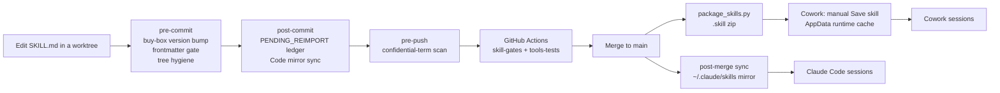

# ORA Skills

**The source of truth for Oxford Realty Advisors' custom Claude Code and Cowork skills.**
One folder per skill, each a `SKILL.md` (YAML frontmatter plus Markdown procedure) with optional
`references/`, `scripts/`, `templates/` and `assets/`. Together they cover deal sourcing and
underwriting, leasing and legal, asset management, finance, communications, and the automation and
git tooling that keeps the library itself honest.

[](https://github.com/ZeOoba/ora-skills/actions/workflows/tools-tests.yml)
[](https://github.com/ZeOoba/ora-skills/actions/workflows/skill-gates.yml)
[](https://github.com/ZeOoba/ora-skills/actions/workflows/claude-ci-fix.yml)

> [!IMPORTANT]
> This repository is **public**. Never commit tenant PII, financial statements, QuickBooks backups,
> credentials, or the name of an active confidential deal, in a skill, example, fixture or commit
> message. The `pre-push` hook scans for confidential deal terms and fails closed.

## Contents

- [At a glance](#at-a-glance)
- [How skills work](#how-skills-work)
- [Skill catalog](#skill-catalog)
- [Repository layout](#repository-layout)
- [Authoring a skill](#authoring-a-skill)
- [Testing and CI gates](#testing-and-ci-gates)
- [Packaging and deployment](#packaging-and-deployment)
- [Git hooks](#git-hooks)
- [Conventions](#conventions)
- [Retiring a skill](#retiring-a-skill)
- [Further reading](#further-reading)

## At a glance

| | |
|---|---|
| Live skills | 90 top-level folders with a `SKILL.md` (recount: `ls */SKILL.md \| wc -l`) |
| Shared data | [`target-markets.json`](target-markets.json), the canonical buy-box market list, injected into 8 skills at package time |
| Shared code | [`tools/ora_doc_qc.py`](tools/ora_doc_qc.py), the document-QC harness, injected into 5 QC skills as `scripts/ora_doc_qc.py` |
| Tooling | [`tools/`](tools): packaging, CI gates, drift and mirror sync, hooks, 26 `tools/test_*.py` suites |
| CI | [`tools-tests`](.github/workflows/tools-tests.yml), [`skill-gates`](.github/workflows/skill-gates.yml), [`claude-ci-fix`](.github/workflows/claude-ci-fix.yml) |
| Retired skills | [`_archive/`](_archive), never deleted (`linguist-generated`, excluded from default `rg` searches) |

## How skills work

A session never "runs" a skill as code. It scans every `SKILL.md` frontmatter, matches `name` and
`description` against the request, and loads the winning skill's body as instructions for that
turn. The skill may then read its `references/`, run its `scripts/` or fill its `templates/`.

```yaml
---
name: example-skill            # must equal the folder name
description: Use when ...        # triggers + tie-breaks, <= 1024 chars, no versions or dates
---
# Example Skill (v1.0)           # version lives in the body H1, changelog in the body
```

The `description` does all of the routing. It leads with when to use the skill, lists the phrases a
user actually says, and carries the tie-breaks ("NOT X, use Y") that steer a request to the
narrowest match. There is no code path between skills; funnels such as
`verified-deal-recon` → `acquisition-underwriting` → `loi-generation` → `deal-execution` exist only
because each description says so.

### From edit to installed skill



The repo always wins. The Code mirror (`~/.claude/skills/<skill>`) and the Cowork runtime cache are
derived copies; Cowork only picks up a change when a packaged `.skill` is imported by hand.

## Skill catalog

90 skills, grouped by domain. Purposes are condensed from each skill's frontmatter `description`;
the `SKILL.md` is authoritative. Expand a group to browse it.

<details open>
<summary><strong>Acquisitions: sourcing and markets</strong> (9)</summary>

| Skill | Purpose |
|---|---|
| `county-parcel-screen` | Off-market sourcing: scores a county's industrial parcels against the buy-box and builds owner call lists |
| `parcel-data-recovery` | Recovers missing building SF, value, year built and delinquency from county GIS/CAMA sources into a screen workbook |
| `owner-outreach` | Weekly off-market owner letter and call-sheet cycle, deduplicated against the outreach ledger (draft only) |
| `county-sales-monitor` | Recurring digest of recently recorded industrial sales and transfers; market intelligence, not sourcing |
| `listing-enrichment-gate` | Verifies a broker listing's SF, year built, construction, use and ownership history against public records before scoring |
| `verified-deal-recon` | Adversarially verified single-target pre-screen with a pursue/pass call; hands off to underwriting |
| `market-monitor` | Industrial market conditions across target markets: vacancy, rent growth, supply, absorption, cap-rate trends |
| `submarket-spatial-analysis` | Drive-time, demographic, access and locational scoring for a submarket or site |
| `insurance-climate-risk-comparison` | Market-level insurance-cost and natural-hazard benchmarking for a target market; informs, never gates |

</details>

<details open>
<summary><strong>Acquisitions: underwriting</strong> (8)</summary>

| Skill | Purpose |
|---|---|
| `acquisition-underwriting` | The single funnel for deal evaluation: SCREEN, SNAPSHOT, COMPS, UNDERWRITE and FULL modes against the buy-box scorecard |
| `acquisition-underwriting-eval-harness` | Golden-set regression check for doctrine edits to `acquisition-underwriting`; never a live screen |
| `retail-underwrite-lens` | Retail strip and neighborhood-center lens tabs for FULL-mode underwriting |
| `cost-seg-tax-layer` | After-tax returns: cost-segregation allocation, recapture and a per-state tax layer |
| `ora-millage-lookup` | Resolves a parcel's tax rate, assessed value and tax history from verified government sources |
| `ora-flood-zoning-dd` | FEMA flood determination and zoning/permitted-use verification for DD-critical screen items |
| `deal-comparison` | Side-by-side comparison of two or more candidates and portfolio-fit scoring |
| `model-bulk-edit` | Changes one input safely across many financial models and audits workbooks with no cached values |

</details>

<details>
<summary><strong>Acquisitions: offer through closing</strong> (11)</summary>

| Skill | Purpose |
|---|---|
| `loi-generation` | The sole path for letters of intent, with QC gate and state overlays |
| `acquisition-proposal-generation` | Two-page, principal-to-principal business-terms offer; the short alternative to a formal LOI |
| `deal-execution` | Executed LOI through closing: PSA drafting and review (Workflow 2A inbound, 2B outbound), DD and closing checklists |
| `psa-reconciliation` | Extracts canonical PSA facts and cascades them into the workbook, IC memo and other deliverables |
| `title-exam-abstraction` | Abstracts title commitments and recorded instruments into tracked deal-terms items |
| `municipal-permit-portal-recon` | Reconciles permit and certificate-of-occupancy records into a diligence register |
| `estoppel-request-generation` | Builds tenant estoppel requests pre-filled from lease abstracts, with known defects put to the tenant (draft only) |
| `settlement-basis-extraction` | Extracts HUD-1/ALTA settlement statements into a capitalizable-basis register |
| `exhibit-package-builder` | Signature-ready combined PDF: front instrument plus stamped, page-verified exhibits |
| `deal-folder-intake` | Archives a multi-file deal package into a permanent, hash-verified deal folder; does not underwrite |
| `deal-retirement` | Retires a closed or killed deal's artifacts, scheduled tasks and staging records |

</details>

<details>
<summary><strong>Leasing and legal</strong> (10)</summary>

| Skill | Purpose |
|---|---|
| `lease-generation` | New leases on ORA landlord paper from an LOI or deal terms, with redline and LOI conformance memo |
| `lease-addendum` | The sole path for amending, extending or modifying a lease already in effect (draft only) |
| `lease-form-qc` | Pre-execution QC gate for ORA-form leases (long and short form) and the LOI-to-lease audit |
| `masterlease-jurisdiction-rebase` | Rebases state-conformed lease templates onto a new master lease revision |
| `masterlease-revision-cycle` | Adjudicates external AI reviews of the master lease into a new revision with rebased templates |
| `lease-abstraction-pipeline` | Single or batch lease abstraction and rent-roll extraction |
| `lease-renewal-pipeline` | Flags upcoming expirations and routes renewal letters to `document-assembly` |
| `legal-intelligence` | Counterparty-paper review: redlines, clause comparison, blacklines, loan and vendor documents |
| `listing-agreement-qc` | Pre-execution QC gate for broker listing agreements where ORA is owner |
| `pma-qc` | Pre-execution and pre-renewal QC gate for third-party property management agreements |

</details>

<details>
<summary><strong>Asset and property management</strong> (12)</summary>

| Skill | Purpose |
|---|---|
| `tenant-intelligence` | Tenant risk scoring, renewal probability, WALT, concentration and portfolio health metrics |
| `exception-detection` | Anomaly and exception scan across financial, tenant, pipeline and system data |
| `rent-roll-qc` | Final quality audit and institutional formatting of a rent roll before external delivery |
| `rent-roll-reconciliation` | Reconciles the tenant database against an authoritative rent-roll or PM export |
| `pm-portal-pnl-export` | Bulk-downloads and merges monthly P&L exports from property-manager portals |
| `capex-budgeting` | Multi-year capital plans and reserve studies |
| `capital-asset-register` | Building-system asset register: nameplate data, remaining useful life, replacement pipeline |
| `capital-bid-comparison` | Levels competing contractor bids, code-checks them and recommends an award |
| `vendor-management` | Vendor prequalification, scoring and RFPs; QC mode scans a single proposal or service agreement |
| `insurance-renewal-review` | Premium history, rate-versus-exposure split and renewal decision from carrier declarations |
| `tax-appeal` | Property-tax assessment analysis and appeal decision |
| `solar-lease-underwriting` | Evaluates rooftop and community solar lease proposals and benchmarks roof rent |

</details>

<details>
<summary><strong>Finance, capital and reporting</strong> (9)</summary>

| Skill | Purpose |
|---|---|
| `debt-management` | Refinancing, lender selection, term sheets, covenants, hedging; sole path for payoff statements |
| `disposition-analysis` | Hold, refinance, 1031 or sell decision engine (defaults to hold plus cash-out refinance) |
| `cash-position-monitor` | Multi-entity consolidated cash position across the QuickBooks entity files |
| `monthly-close` | Monthly accounting and operations close checklist |
| `annual-cycle` | Year-end close, annual budget, tax planning and audit prep |
| `portfolio-growth` | Long-range AUM growth, acquisition capacity and capital-deployment scenarios |
| `portfolio-reporting` | Portfolio-level and investor-ready performance reporting |
| `ratify-hurdle-rate` | Formal ratification workflow for the unlevered IRR hurdle rate |
| `personal-portfolio` | Analysis of the principal's personal (non-firm) investments |

</details>

<details>
<summary><strong>Communications and documents</strong> (7)</summary>

| Skill | Purpose |
|---|---|
| `communication-intelligence` | Context-enriched drafting for broker, lender, vendor and attorney correspondence |
| `tenant-email` | Tenant-facing email drafting: renewals, notices, maintenance, rent |
| `document-assembly` | Template-driven letters and memos populated from Notion (not LOIs, addenda or estoppels) |
| `artifact-to-docx-report` | Turns a published Claude artifact into an ORA-styled Word report with charts and KPI tiles |
| `evidence-dossier-drafting` | Multi-agent drafting with a cited facts dossier and an adversarial refuter pass |
| `daily-brief` | Daily CRE news, markets, portfolio watch and competitive intelligence brief |
| `outlook-calendar-sync` | Adds or refreshes dated items on the Outlook calendar via desktop Outlook COM |

</details>

<details>
<summary><strong>Automation and scheduled-task fleet</strong> (6)</summary>

| Skill | Purpose |
|---|---|
| `register-scheduled-task` | The sole supervised path to register, update, pause or retire a scheduled task on either fleet |
| `automation-health-monitor` | Scheduled health check of every enabled task plus the off-fleet substrates |
| `fleet-advisory-remediation` | Works through fleet-status and health-monitor advisories |
| `orphaned-task-forensics` | Traces a stale output back to its producer task; recovers a lost task `SKILL.md` |
| `notion-quota-fallback` | Fallback when Notion SQL-mode query quota is exhausted or the UI filter hangs |
| `graph-app-registration` | Runbook for Entra app registration, Microsoft Graph access and secret rotation |

</details>

<details>
<summary><strong>Engineering, git and repo tooling</strong> (12)</summary>

| Skill | Purpose |
|---|---|
| `isolated-commit` | Lands your own reviewed change in a shared checkout that other sessions may be editing |
| `dirty-tree-triage` | Attributes and safely settles uncommitted work across the shared checkouts |
| `branch-catchup` | Brings a long-lived branch up to date with `origin/main` in a worktree, conflict by conflict |
| `adversarial-merge-gate` | Second-reviewer gate before merging blast-radius or multi-session changes |
| `merge-ready` | Merge-readiness gate for one or several PRs, merge on explicit yes, post-merge cleanup |
| `land` | Thin readiness-to-merge chain for one explicitly named PR |
| `package-and-stage-skill` | Packages a repo skill edit into a validated, importable `.skill` |
| `repo-architecture` | Navigation guide to the most active ORA repos: layout, data flow, deploy path, gotchas |
| `repo-architecture-review` | Cross-repo architecture-diagram audit producing a ranked punch list |
| `xlsx-warehouse-importer` | Scaffold for loading a spreadsheet or JSON extract into the command-center SQLite warehouse |
| `security-and-hardening` | Dedicated security review or hardening pass when security is the explicit ask |
| `file-reconciliation` | Hash-diff dedupe of folder trees and resolution of conflicting document versions |

</details>

<details>
<summary><strong>Setup, governance and website</strong> (6)</summary>

| Skill | Purpose |
|---|---|
| `ora-setup-audit` | The canonical audit of the Claude Code/Cowork setup: skills, plugins, connectors, hooks, fleets |
| `external-artifact-intake` | Evaluates an outside prompt, repo, skill or plugin against the current setup |
| `ora-open-decisions` | Collects every open decision in a session and asks them as ranked multiple choice |
| `cowork-settings` | Versions, diffs and publishes the Cowork global settings document |
| `deploy-site` | Builds and deploys the firm website to Netlify (preview by default) |
| `website-perfection` | Website performance, SEO, structured data, headers/CSP and accessibility audits |

</details>

Platform skills (`docx`, `xlsx`, `pptx`, `pdf`, `skill-creator`, `schedule` and similar) resolve from
the Claude platform at runtime and are deliberately not vendored here.

## Repository layout

```text
ora-skills/
├── <skill>/                 one folder per skill (90)
│   ├── SKILL.md             required: frontmatter + procedure
│   ├── references/          optional lookup data and doctrine
│   ├── scripts/             optional helpers (and their test_*.py suites)
│   ├── templates/ assets/   optional document templates and static files
│   └── PACKAGING-NOTE.md    optional skill-specific packaging notes
├── target-markets.json      shared buy-box market list (version-gated)
├── tools/                   packaging, CI gates, sync, lint, tests
│   └── hooks/               canonical git hooks (installed per clone)
├── .github/workflows/       tools-tests, skill-gates, claude-ci-fix
├── docs/plans/              dated review and improvement plans
├── plugins/                 Cowork plugin bundles (empty by design)
├── _archive/                retired skills and dated work records
├── CLAUDE.md                rules an agent must follow before editing
└── KNOWN_ISSUES.md          Cowork-surface tooling defects and workarounds
```

Not tracked: `_staging/` (drift ledgers `PENDING_REIMPORT.md` and `STORE_AHEAD_OF_REPO.md`, rescue
copies), built `*.skill` / `*.plugin` packages, `.worktrees/` and `.claude/worktrees/`, and the
eval harness's daily `runs/` output.

### Key tools

| Area | Scripts |
|---|---|
| CI gates | `skill_ci_gates.py`, `run_suite.sh`, `run_skill_suites.sh` |
| Packaging | `package_skills.py`, `package_batch.py`, `build_plugin.py`, `release_plugin.py` (plugin tooling dormant) |
| Drift and reimport | `repo_first_check.py`, `pending_reimport.py`, `skill_drift_report.py`, `reimport_cycle.py`, `reimport_correlate.py`, `stage_transfer.py`, `entry_b_precheck.py`, `verify_installed_cache.py`, `verify_install.ps1` |
| Mirror sync | `sync_appdata_mirror.py` (Cowork cache), `sync_local_skills_mirror.py` (Code mirror), `capture_runtime_cache.py` + `register_capture_task.ps1` |
| Frontmatter and lint | `description_budget.py`, `desc_lengths.py`, `frontmatter_sweep.py`, `skill_md_normalize.py`, `script_resource_lint.py`, `doctrine_consistency.py` |
| Hooks and safety | `install_hooks.py`, `prepush_confidential_scan.py`, `catch_up_main.py` |
| Shared and misc | `ora_doc_qc.py`, `review_copy.py`, `pause_resume.py`, `notion_fetch_digest.py`, `usage_ledger.py`, `backtest_agenda.py` |

## Authoring a skill

- [ ] Work in a worktree or a clean checkout; run `git fetch origin` and `git status -sb` first. This repo
      is edited by concurrent sessions.
- [ ] Run `python tools/repo_first_check.py` (local machines only) so an uncommitted Cowork-side edit is
      reconciled before your commit's mirror sync can overwrite it.
- [ ] Create `<skill-name>/SKILL.md`; the folder name is kebab-case and equals the frontmatter `name`.
- [ ] Write the `description` as routing, not summary: lead with "Use when ...", list trigger phrases,
      add "NOT X, use Y" tie-breaks, stay within 1024 characters. No version, date, changelog or step
      summary (the gate rejects them). Overflow vocabulary goes in a `## BODY TRIGGERS` section.
- [ ] Put the version in the body H1 as `# Title (vX.Y)` and history under `## Changelog`. If a change
      touches a scored or governor constant (DSCR, LTV, scorecard weights), say explicitly whether
      the constant changed; governor constants need explicit owner approval.
- [ ] For a retrieval-heavy step, state a budget in the body (for example, at most five tool calls
      before synthesizing).
- [ ] Never copy `target-markets.json` or `tools/ora_doc_qc.py` into the skill; declare the dependency
      in `SHARED_ROOT_DEPS` in [`tools/package_skills.py`](tools/package_skills.py).
- [ ] Skill tests go in `test_*.py` under the skill folder, stdlib `unittest` with a `__main__` runner.
      CI discovers them automatically.
- [ ] Add the skill to the [catalog](#skill-catalog) in backticks. `skill_ci_gates.py frontmatter`
      fails any skill whose name does not appear in this README.
- [ ] Run `bash tools/run_suite.sh` and `bash tools/run_skill_suites.sh`; stage explicit paths only and
      check `git diff --cached --stat` before committing.

## Testing and CI gates

Install the test dependencies first. A missing dependency shows up as `SKIP`, which fails the gate.

```bash
python -m pip install pymupdf python-docx reportlab lxml openpyxl   # plus poppler-utils for pdftotext
bash tools/run_suite.sh               # tools/test_*.py
bash tools/run_skill_suites.sh        # packaged-layout check + every skill-level test_*.py
python tools/skill_ci_gates.py frontmatter
```

`run_suite.sh` fails on any failure, any unallowed skip (the only allowance is
`tools/test_package_census.py=1`, its Windows-only long-path test, off Windows), any file that runs
zero tests, and any bare module-level `def test_*`. The one plain-assert script exempt from the
`unittest` rule is `tools/test_description_budget.py`, which must print `all checks passed`.

| Workflow | Trigger | What it enforces |
|---|---|---|
| [`tools-tests`](.github/workflows/tools-tests.yml) | every push, manual | `bash tools/run_suite.sh` on Python 3.13 with PyMuPDF |
| [`skill-gates`](.github/workflows/skill-gates.yml) / `skill-gates` | every push, manual | `frontmatter` (all skills, tree hygiene, shared-dep declarations, README inventory), `memory-files`, `target-markets --base auto`, `suite-continuity --base auto` |
| [`skill-gates`](.github/workflows/skill-gates.yml) / `skill-tests` | every push, manual | `bash tools/run_skill_suites.sh` with poppler and the document libraries |
| [`claude-ci-fix`](.github/workflows/claude-ci-fix.yml) | failed PR check suite, changes-requested review, or CodeRabbit comment | Runs `anthropics/claude-code-action` (SHA-pinned) with a fixed prompt to push a fix; only PRs whose head is in this repo and whose author (and reviewer) is owner, member or collaborator. No `@claude` trigger (removed 2026-11-12: on a public repo the comment-built prompt is outsider-writable) |

The gates that matter most when you change things:

- **Buy-box version bump.** Any change to `target-markets.json` must bump its `version` (and
  `updated`). `pre-commit` blocks locally; `target-markets --base auto` re-checks against the PR base so
  `--no-verify` cannot skip it.
- **Suite continuity.** A skill test suite present at the PR base must still be discovered on HEAD,
  unless a file added under `_archive/` has a path ending `<skill>/<rest>` or
  `<skill>_retired-YYYY-MM-DD/<rest>`, or some commit in the range has a line starting
  `Suite-Removed: <path>`. The check is path-only and runs in CI, not in the local runner. Practice is
  stricter: `git mv` to `_archive/<skill>_retired-YYYY-MM-DD` and put the trailer on the removing commit.
- **Opting a suite out.** Add a top-level `CI_EXCLUDE = "<reason>"` to the test file; an empty reason
  fails.
- **Memory files.** No tracked file may be a Claude memory file or a single-entry event-log draft.

> [!NOTE]
> CI runs on GitHub-hosted `ubuntu-latest` by default. The repo variable `CI_RUNNER=self` moves both
> gating workflows to a self-hosted Windows runner. A red check with no steps and a 404 log is usually
> an Actions billing block, not a test failure; read the annotation and verify locally. Failures in
> Actions-created check suites do not trigger `claude-ci-fix`.

## Packaging and deployment

```bash
python tools/package_skills.py <outdir> <skill> [<skill> ...]   # output directory FIRST
```

- The output directory comes first. Swapped arguments once packaged into a skill's own source tree;
  the script and `--check-tree-hygiene` now refuse that.
- **Never use PowerShell `Compress-Archive`.** It writes backslash zip paths that the Claude importer
  rejects.
- Shared dependencies are injected at package time. `target-markets.json` goes to
  `acquisition-underwriting`, `annual-cycle`, `daily-brief`, `deal-comparison`,
  `insurance-climate-risk-comparison`, `market-monitor`, `portfolio-growth` and
  `submarket-spatial-analysis`; `tools/ora_doc_qc.py` goes to `lease-form-qc`, `lease-addendum`,
  `listing-agreement-qc`, `pma-qc` and `vendor-management`. Packaging refuses a shared file that is
  dirty or uncommitted unless `--allow-dirty-shared` is passed.
- Import the `.skill` into Cowork with **Save skill**. Nothing in this repo can reimport for you;
  `_staging/PENDING_REIMPORT.md` lists skills whose committed content is ahead of the runtime cache.
- Plugin bundles would build with `python tools/build_plugin.py <plugin> <outdir>`, but none exist;
  see [`plugins/README.md`](plugins/README.md).

## Git hooks

Install once per clone, and again after pulling hook or scanner changes:

```bash
python tools/install_hooks.py          # --check verifies without writing
```

The installer writes shims into the clone's untracked `<git-common-dir>/ora-hooks/` and points
`core.hooksPath` there, so every branch and worktree runs the hooks from the tree being committed.

| Hook | Behaviour |
|---|---|
| `pre-commit` | Blocks: `target-markets.json` change without a `version` bump; frontmatter gate on staged skills; stray `.skill`/`.plugin` inside a skill folder. Advisory: `repo_first_check.py --check-staged` rescues a cache copy that is ahead of the repo, then `sync_appdata_mirror.py --check-staged` copies staged skills into the Cowork cache |
| `post-commit` | Records cache-stale skills in `PENDING_REIMPORT.md` and re-syncs existing Code mirrors (fail-open) |
| `post-merge`, `post-rewrite` | Sweeps all Code mirrors and syncs the Cowork cache for the changed range (`main` only) |
| `pre-push` | Runs `prepush_confidential_scan.py` against everything the push makes new (messages, diffs, file contents including archives, paths, refs). Fails closed on an unreadable roster or git error; terms are never printed |

Local-only hooks depend on the Windows AppData runtime cache and do nothing useful in a cloud
checkout. `git commit --no-verify` and `git push --no-verify` exist for emergencies; CI re-runs the
commit-time gates regardless.

## Conventions

- **Repo first.** This repo is canonical. Cowork-side edits (create-skill, `save_skill`, direct cache
  edits) reach only the runtime cache and leave no git trace; reconcile them with
  `repo_first_check.py` before committing.
- **Single writer.** Stage explicit paths, never `git add -A` or `git commit -a`; split any commit whose
  `--stat` shows files you did not touch. Do git writes from a Code session, not a Cowork sandbox
  (see [`KNOWN_ISSUES.md`](KNOWN_ISSUES.md)).
- **Inline versioning.** Version in the H1, dated changelog in the body; no separate CHANGELOG files.
- **Supporting folders.** Only `references/`, `scripts/`, `templates/` and `assets/`, plus optional
  `PACKAGING-NOTE.md`, `INSTALLATION.md` or `SCHEDULED_TASK.md`.
- **Optional frontmatter.** `user-invocable: true` and `allowed-tools` are used sparingly (for example
  `deploy-site`, `tenant-email`, `lease-renewal-pipeline`); some skills carry `license` or `metadata`.
- **Backups.** `.backup-*` sidecars are gitignored mid-session rollback files; git history is the
  durable record.
- **Line endings.** Git stores LF; hooks and shell scripts are forced to LF and PDFs are binary.

## Retiring a skill

Never delete. Every step below exists because a past retirement skipped it.

1. Find what still depends on the skill, and repoint or tombstone every hit in the same commit:
   ```bash
   git grep -n -w "<skill>" -- . ':(exclude)<skill>' ':(exclude)_archive'
   ```
   Also check the live scheduled-task definitions on the local machine.
2. Archive under the dated name: `git mv <skill> _archive/<skill>_retired-YYYY-MM-DD`, with the
   reason in the commit message. The retired-skill guard recognizes only that exact pattern. Add a
   `Suite-Removed: <path>` trailer for any test suite it drops.
3. If it was a member of the retired `ora-operations-extensions` bundle, add it to the `RETIRED` map in
   `tools/test_build_plugin.py`.
4. Run both suites with zero `FAIL` and zero `SKIP` before committing.
5. Remove it from the [catalog](#skill-catalog).

Retired so far include `deal-screen`, `cap-rate-snapshot`, `market-comp-analyzer` and `underwrite`
(absorbed into `acquisition-underwriting` modes), `rent-comp` (absorbed into COMPS mode), and
`census-acs-extract`, `re-operations`, `maintenance-analytics`, `conversation-archival`,
`code-debugging-optimizations`, `oxford-cc-strategic-audit`, `build-with-gate-reviews` and
`investor-relations`.

## Further reading

- [`CLAUDE.md`](CLAUDE.md): the short rule set an agent must follow before editing.
- [`KNOWN_ISSUES.md`](KNOWN_ISSUES.md): Cowork bridge, git lock and concurrent-writer workarounds.
- [`plugins/README.md`](plugins/README.md): why `plugins/` is empty and how bundles would work.
- [`docs/plans/`](docs/plans): dated skill-improvement and data-flow reviews.

**Recovery.** If a checkout is lost, clone `github.com/ZeOoba/ora-skills`. Local
`skill-audit-YYYYMMDD-HHMMSS/` snapshots under `~/.claude/backups/` are a fallback; re-exporting from
the Cowork skills UI is the last resort.
