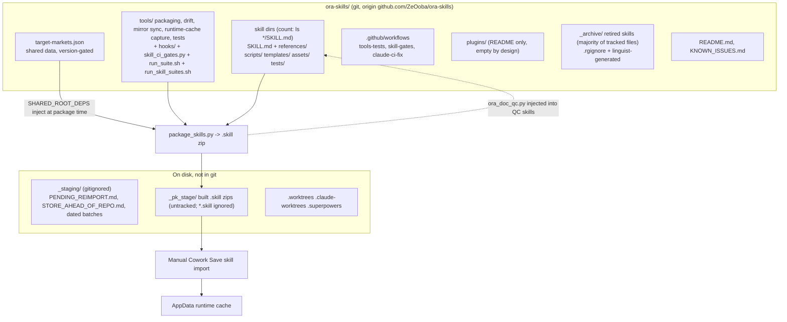
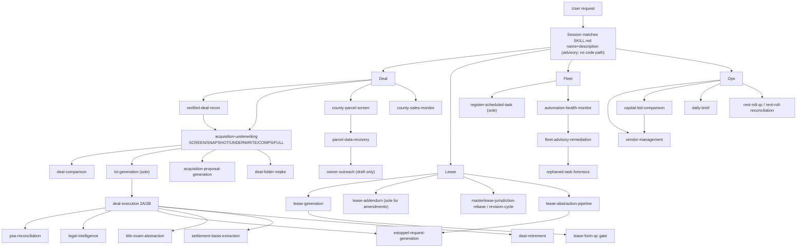
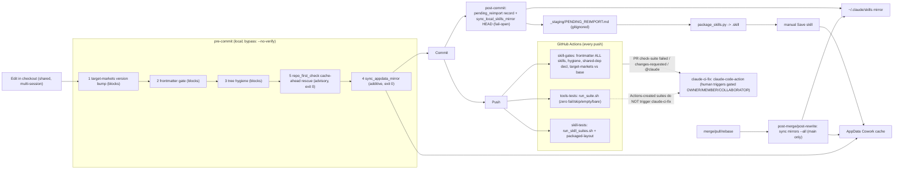
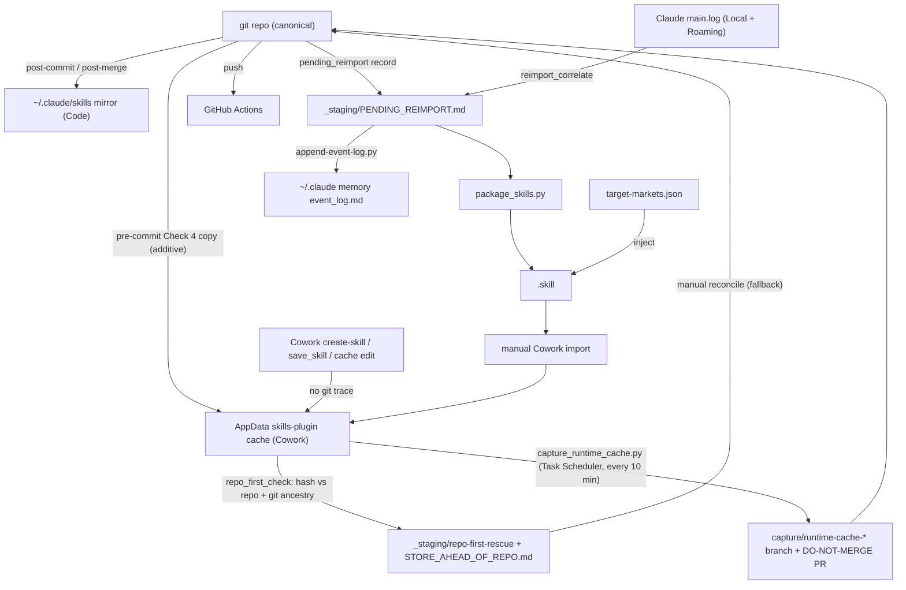

# ORA Authoritative Skills Library

This directory is the **source of truth** for Oxford Realty Advisors' custom Claude Code
"Skills" — the SKILL.md definitions (YAML frontmatter + Markdown instructions, plus
supporting `references/`, `scripts/`, `templates/`, and `assets/`) that drive deal
sourcing/underwriting, portfolio operations, finance, communications, and internal
automation across Gabriel Goldberg's real-estate business.

## What this repo is, and how a skill actually gets used

Each top-level folder is one Skill. A Claude Code / Cowork session discovers skills by
scanning every `SKILL.md`'s YAML frontmatter — the `name` and `description` fields are
matched against the user's request or the current task context to decide which skill(s)
to trigger (the `description` field is doing the routing work, which is why several
skills here pack it with explicit trigger phrases). Once triggered, the Skill tool loads
the Markdown body as working instructions for that turn, and the skill may in turn read
its own `references/*.md` for lookup data, invoke scripts under `scripts/`, or pull from
`templates/`/`assets/`. Skills are not code that "runs" independently — they are
structured context + procedure that Claude follows.

## Scope

Git-tracked as of 2026-04-16 (workflow-audit Fix #3a). Scoped to this subtree only — the
enclosing `Cowork OS/` and `OneDrive - Oxford Capital Partners (1)/` roots are NOT
git-tracked and must not be (they contain QBB backups, tenant PII, and financial
statements that should never enter a repo).

## Repo structure


<!-- diagram-verified: 2026-10-06 against .gitignore, tools/package_skills.py SHARED_ROOT_DEPS -->

**Reading the diagram:** everything lives flat under the repo root — each
skill folder (`acquisition-underwriting/`, `loi-generation/`, etc.) sits directly under
`Repo root`, alongside `target-markets.json` (shared buy-box data), `tools/`, `plugins/`,
`_staging/`, and `_archive/`. Inside a skill folder, only `SKILL.md` is required; the rest
(`references/`, `templates/`, `PACKAGING-NOTE.md`, and so on) exists only where that skill
actually needs it, which is why `acquisition-underwriting/` and `loi-generation/` are shown
with different contents. The bottom half of the diagram traces the two things that
actually happen to this repo: **packaging** (`tools/package_skills.py` or
`tools/build_plugin.py` zips a skill or plugin bundle for Cowork's "Save skill" import,
and a separate one-way sync mirrors shipped files into the AppData runtime cache — this
repo always wins on divergence) and **triggering** (a live Claude Code / Cowork session
scans every `SKILL.md`'s frontmatter, matches `name`/`description` against what the user
just asked for, and — once a skill triggers — loads its Markdown body as instructions for
that turn, optionally pulling from `references/` as it goes).

## How routing works across skills

Skills do not call each other mechanically; the `description` of each `SKILL.md` carries the
"NOT X, use Y" tie-breaks that steer a session to the narrowest match. The funnels below are
the ones stated in the frontmatter of the skills involved.


<!-- diagram-verified: 2026-10-06 (advisory routing; node names checked against skill dirs, edges per SKILL.md descriptions spot-checked only) -->

## Directory / skill inventory

**Git-tracked skill directories** (count them with `ls */SKILL.md | wc -l`; no number is hardcoded here because it drifts) (each contains its own `SKILL.md`), plus four
non-skill support directories: `tools/` (packaging/build/hook scripts), `plugins/`
(version-controlled Cowork plugin bundles), `_staging/` (dated pending-reimport batches,
plus the gitignored `PENDING_REIMPORT.md`/`STORE_AHEAD_OF_REPO.md` drift ledgers), and
`_archive/` (retired skills, kept for reference).

Grouped by rough function (one-line purpose pulled from each skill's frontmatter
`description`, condensed):

**Acquisition & deal lifecycle** — sourcing through close
- `acquisition-underwriting` — canonical entry point for deal evaluation (SCREEN / SNAPSHOT / UNDERWRITE / COMPS / FULL modes, Buy Box & Scorecard)
- `acquisition-underwriting-eval-harness` — golden-set regression harness for `acquisition-underwriting`: replays 6 frozen SCREEN-mode deals against current doctrine and flags score deltas after a doctrine edit (never a live deal screen)
- `county-parcel-screen` — off-market direct-to-owner county-parcel screen: pulls a county's industrial parcels, scores each 0-100 against the buy-box, mines delinquency/estate/seller-in-motion signals, delivers ranked call-list workbooks
- `county-sales-monitor` — recurring digest of recently recorded industrial sales (under 150K SF, trailing 30 days) from `county-parcel-screen`'s endpoint registry, written to a Notion comps database; market intelligence, not sourcing
- `owner-outreach` — weekly off-market owner cold-outreach letter pipeline (draft only)
- `parcel-data-recovery` — county-level SF/value/year-built/delinquency recovery for off-market screens
- `ora-flood-zoning-dd` — FEMA flood + zoning/permitted-use due-diligence determinations
- ~~`census-acs-extract`~~ — retired 2026-08-05 (zero use across git history, event_log, and Notion; no doctrine dependency). Archived script still runnable at `_archive/census-acs-extract_retired-2026-08-05/census_acs_extract.py`
- `ora-millage-lookup` — resolves a parcel's property-tax rate/taxable base from verified government endpoints; companion to acquisition-underwriting STAGE 2.5
- `cost-seg-tax-layer` — after-tax returns for an ORA underwrite: cost-segregation allocation by property type (industrial/flex default, retail override), class-by-class recapture, per-state tax layer (WI, OH, IN, MD, MO, KS, TN)
- `municipal-permit-portal-recon` — permit and certificate-of-occupancy diligence: pulls the Auditor permit list and county permit portal, reconciles, flags gaps, builds the register
- `market-monitor` — industrial market conditions, vacancy, rent growth, supply pipeline tracking
- ~~`rent-comp`~~ — retired 2026-08-05; its comp-grid discipline was absorbed into `acquisition-underwriting` on 2026-08-12 (the retirement record wrongly credited `market-monitor` — see the 2026-08-12 event_log entry)
- `submarket-spatial-analysis` — drive-time, demographics, and locational scoring
- `deal-comparison` — side-by-side deal and portfolio-fit comparison
- `loi-generation` — the sole letter-of-intent drafting path
- `acquisition-proposal-generation` — seller-facing two-page, non-legalistic business-terms Acquisition Proposal; the short principal-to-principal alternative to `loi-generation`'s formal LOI
- `deal-execution` — PSA negotiation through closing (redlines, DD checklist, closing statement)
- `exhibit-package-builder` — signature-ready Combined PDF: front instrument + exhibit contents sheet + every source instrument, stamped Exhibit A-n of N and verified page-by-page against source
- `psa-reconciliation` — PSA fact extraction/cascade reconciliation against the LOI
- `title-exam-abstraction` — abstracts title exams, commitments, preliminary reports and recorded instruments, turning every encumbrance into a tracked deal-terms-register item
- `settlement-basis-extraction` — extracts HUD-1/ALTA settlement statements into a capitalizable-basis register (CHARGE_DETAIL, BASIS_REGISTER, EXCHANGE_1031) at every acquisition/disposition closing
- `deal-retirement` — retires deal artifacts/tasks on close or kill; appends the decision ledger
- `verified-deal-recon` — adversarially-verified single-target pre-screen (the default before underwriting); hands off to `acquisition-underwriting`, never underwrites itself
- `listing-enrichment-gate` — verifies a broker listing's SF, year built, construction, use class, site coverage, owner and flip history against county/public sources before scoring; certifies the record CERTIFIED/PROVISIONAL and feeds `ora-deal-sourcing-scan` STEP 3D
- `deal-folder-intake` — archives a multi-file acquisition package into a permanent, hash-verified deal folder; does not underwrite or screen

**Portfolio & asset operations**
- ~~`re-operations`~~ — retired 2026-08-05 (no direct-execution evidence; ops scope covered by `rent-roll-reconciliation`, `lease-renewal-pipeline`, `tenant-intelligence`, `ora-pm-ledger`, `ora-tenant-hubspot-reconciliation`)
- ~~`maintenance-analytics`~~ — retired 2026-08-05 (zero use for CapEx/maintenance forecasting output); no successor — `capex-budgeting` now sources failure horizons manually
- `tenant-intelligence` — tenant risk scoring, renewal probability, portfolio health metrics
- `rent-roll-qc` — final QC/polish pass on rent rolls before external delivery
- `pm-portal-pnl-export` — bulk-downloads historical monthly P&L Excel exports from Yardi Voyager or Rent Manager Owner Web Access, renames and merges them; also produces first-12-month NOI for the underwriting back-test
- `rent-roll-reconciliation` — reconciles the Notion Tenant DB against an authoritative rent-roll export
- `lease-abstraction-pipeline` — single or batch lease abstraction / rent-roll extraction
- `estoppel-request-generation` — builds tenant estoppel certificate requests from abstracted lease data, pre-filling every certified fact and putting each known defect to the tenant (draft only)
- `lease-renewal-pipeline` — flags upcoming expirations and drafts renewal templates
- `lease-generation` — new-lease production: from an LOI, term sheet or deal terms to an execution-ready lease on ORA landlord paper, with a redline and an LOI conformance memo (amendments go to `lease-addendum`)
- `lease-addendum` — the sole path for amending, extending or modifying a lease already in effect (rent change, tenant substitution, premises change); draft only
- `lease-form-qc` — pre-execution QC gate for leases on ORA's own landlord form (57-check scan, PASS/FAIL; standalone LOI-Lease Audit mode)
- `masterlease-jurisdiction-rebase` — rebases jurisdiction-conformed Master Lease property templates onto a new master revision; companion to lease-form-qc
- `masterlease-revision-cycle` — end-to-end master-lease revision: adjudicates external AI reviews into a new master revision with rebased property templates; chains `lease-form-qc` and `masterlease-jurisdiction-rebase`
- `legal-intelligence` — lease/contract clause library and legal document analysis
- `listing-agreement-qc` — pre-execution QC gate for broker listing agreements on counterparty paper where ORA is Owner (25 defects; run before any listing is signed)
- `pma-qc` — pre-execution and pre-renewal QC gate for third-party property management agreements where ORA or an ORA entity is Owner
- `retail-underwrite-lens` — retail strip / neighborhood-center lens tabs for `acquisition-underwriting` FULL mode (Stage 2.9 alt-asset track): rent-basis cases, required-rent solve, rent normalization, outlot option, comp-implied income value; runs only past the Gate 6 retail-only rule
- `solar-lease-underwriting` — rooftop/community-solar lease underwriting: counterparty economics and rent-benchmarking for third-party rooftop energy leases
- `tax-appeal` — property tax assessment analysis and appeal decision engine
- `insurance-renewal-review` — property insurance renewal review: extracts carrier declarations, builds per-property premium history, separates rate from exposure, diffs each renewal; ships an XLSX and an HTML dashboard
- `insurance-climate-risk-comparison` — market-level comparison of insurance cost and natural-disaster/climate risk for a target market against the national average and ORA's other markets; informs underwriting, never gates a deal
- `disposition-analysis` — hold / refinance / 1031 / sell decision engine
- `capex-budgeting` — multi-year capital plan and reserve studies
- `vendor-management` — vendor prequalification, scoring, RFP issuance, contract intake, performance review; QC mode = pre-signature defect scan of a single vendor proposal or service agreement
- `capital-bid-comparison` — levels two or more contractor proposals for the same building-system scope, code-checks each, and recommends an award; runs before `vendor-management` QC mode, which then gates the awarded bid
- `capital-asset-register` — per-property building asset register: nameplate capture, remaining useful life, and the replacement pipeline feeding the annual capital plan

**Finance, capital & investor relations**
- `debt-management` — refinancing, lender selection, term-sheet negotiation, covenants
- `cash-position-monitor` — multi-entity consolidated cash position across QuickBooks accounts
- `portfolio-growth` — long-term AUM growth modeling and strategic capital planning
- `portfolio-reporting` — portfolio-level and investor-ready reporting output
- `monthly-close` — the full monthly accounting/operations close checklist
- `annual-cycle` — year-end/annual planning cycle (budget, tax planning, audit prep)
- `ratify-hurdle-rate` — formal ratification workflow for the firm's IRR hurdle rate
- `model-bulk-edit` — safely changes one input across many financial models at once and audits workbooks whose formulas carry no cached values
- `personal-portfolio` — Gabriel's personal investment portfolio analysis

**Communications & documents**
- `communication-intelligence` — context-enriched drafting for broker/lender/vendor/attorney mail
- `tenant-email` — tenant-facing email drafting (renewals, notices, maintenance, rent)
- `document-assembly` — template-driven document generation from Notion data (10 templates; not LOIs, lease addenda or estoppels)
- `artifact-to-docx-report` — turns a published Claude artifact (dashboard/review page with embedded data) into an ORA-styled Word report with charts, KPI tiles and a 90-day action plan; bundles the extract, chart, docx-build and render-check scripts
- `evidence-dossier-drafting` — multi-agent drafting pipeline: a numbered facts dossier, an inline citation on every claim, and an adversarial refuter that kills uncited or mis-cited claims before anything publishes
- `daily-brief` — daily CRE news/market/portfolio intelligence brief
- `outlook-calendar-sync` — adds or refreshes dated items (deadlines, to-dos, hearings) on Gabriel's Outlook calendar via desktop Outlook COM when the M365 connector cannot write calendar events
- ~~`conversation-archival`~~ — retired 2026-08-05 (its entire Notion footprint was evidence-checked, not merely absent)

**Systems, automation & infrastructure**
- `automation-health-monitor` — scheduled health check across the dual-fleet scheduled-task registry
- `fleet-advisory-remediation` — auto-triages fleet-status advisories, registers/retires tasks
- `orphaned-task-forensics` — root-causes stale scheduled-task output back to its producer
- `register-scheduled-task` — the sole supervised path for registering/updating scheduled tasks
- `exception-detection` — anomaly/exception scan across financial, tenant, and pipeline data
- `graph-app-registration` — Azure AD app registration / Microsoft Graph API access runbook
- `deploy-site` / `website-perfection` — build/deploy (`deploy-site`) and audit/optimize (`website-perfection`: PageSpeed, SEO, structured data, headers/CSP, accessibility) oxfordra.net
- `notion-quota-fallback` — fallback for Notion SQL-mode `Query Data Source` quota errors, and for the Notion UI filter hanging in browser automation
- `ora-open-decisions` — collects every decision still open in a session and asks them as ranked multiple choice, recommended option first
- ~~`code-debugging-optimizations`~~ — retired 2026-08-05 (zero use; redundant with `website-perfection`)
- ~~`oxford-cc-strategic-audit`~~ — retired 2026-08-05 (hygiene commits exist, but no evidence a full audit run/report was produced or consumed)
- `package-and-stage-skill` — packaging/staging helper for this repo itself
- `dirty-tree-triage` — triages uncommitted working trees across ORA's shared checkouts: attributes changes to sessions with evidence, settles them by mtime, isolates and commits only what is safe
- `isolated-commit` — lands your own reviewed change in a shared ORA checkout that other sessions may be editing (claim, stage by pathspec, independent review, push)
- `adversarial-merge-gate` — second-reviewer gate before merge for blast-radius changes (hooks, config, governance, financial or security-gate code), multi-session branches, or PRs whose commit message makes verification claims
- `merge-ready` — merge-readiness gate for one or several PRs: runs the standard gate order, then cleans up the worktree after merge.
- `land` — readiness-to-merge-to-verified-pull chain for one PR in any ORA repo, with a checked-in allowlist of known external CI failures.
- `branch-catchup` — brings a long-lived branch up to date with origin/main safely in a shared, dirty checkout (worktree-isolated; per-conflict resolution by which side is the reviewed superset)
- `file-reconciliation` — hash-diff dedupe/reconciliation between file trees
- `repo-architecture-review` — cross-repo architecture-diagram audit (unbounded loops, off-fleet automation, dual-write drift, disconnected build steps, dead links, missing financial-code gates); read-only, hands off fixes to normal lane triage
- `repo-architecture` — navigation guide to Gabriel's 7 most-active repos: purpose, layout, data flow, deploy path, gotchas, files to read first (point-in-time snapshot; verify against the repo)
- `xlsx-warehouse-importer` — scaffold for loading a spreadsheet/JSON extract into the oxford-command-center SQLite warehouse: validation rules, property-id crosswalk, idempotency, test checklist
- `external-artifact-intake` — evaluates an external AI artifact (prompt, repo, skill, plugin, process proposal) against the current setup and decides adoption
- `ora-setup-audit` — formal audit of the Claude Code/Cowork setup (skills, plugins, MCP connectors, hooks, dual scheduled-task fleet) scored for accuracy, performance and token spend, with a keep/fix/combine/delete call per finding
- `security-and-hardening` — dedicated security review or hardening pass (auth, data storage, integrations, untrusted input) once security is the explicit ask
- ~~`build-with-gate-reviews`~~ — retired 2026-08-05 (zero use across three independent verification passes)
- `cowork-settings` — version/diff/publish the Cowork Global Settings document

**Shared data:** `target-markets.json` (repo root) — canonical buy-box market list,
injected at package time into `acquisition-underwriting`, `daily-brief`, `deal-comparison`,
`market-monitor`, and `insurance-climate-risk-comparison` (`SHARED_ROOT_DEPS` in
`tools/package_skills.py`). Not duplicated into any skill folder — see "Conventions" below.
`tools/ora_doc_qc.py` is likewise a shared dependency: packaged into `lease-form-qc`, `lease-addendum`,
`listing-agreement-qc`, `pma-qc`, and `vendor-management` as `scripts/ora_doc_qc.py`.

## Sync, packaging and CI flow

Git hooks live in `tools/hooks/` (`core.hooksPath=tools/hooks`, set locally per clone). They
keep the two local stores (the Code-surface `~/.claude/skills/<skill>` mirror and the Cowork
AppData runtime cache) aligned with this repo, which stays canonical. Cowork itself only
re-imports when a `.skill` is manually imported via "Save skill".


<!-- diagram-verified: 2026-10-06 against tools/hooks/*, tools/*.py, .github/workflows/* -->

**Data flow and sources of truth.** The repo is canonical; the Code mirror and the Cowork cache are derived copies, and Cowork-side edits leave no git trace until `repo_first_check` finds them.


<!-- diagram-verified: 2026-10-06 against tools/pending_reimport.py, sync_local_skills_mirror.py, reimport_correlate.py -->

**Surfaces.** Code sessions resolve skills from the local `~/.claude/skills/<skill>` mirror; Cowork
sessions resolve from the AppData runtime cache. Nothing in this repo wires Chat to it, so that
path is not documented here.

**Hooks (`tools/hooks/`).**
- `pre-commit`: Check 1 requires a `version` bump on any `target-markets.json` change; Check 2 runs
  the same frontmatter gate as packaging (`name` equals directory, `description` present and
  at most 1024 characters, named-count headers); Check 3 (`package_skills.py --check-tree-hygiene`)
  blocks stray `.skill`/`.plugin` artifacts inside skill directories; Check 5
  (`repo_first_check.py --check-staged`) is advisory and rescues a cache copy that is ahead of
  the repo; Check 4 (`sync_appdata_mirror.py --check-staged`) copies staged skills into the cache.
- `post-commit`: records skills left cache-stale (`pending_reimport.py`) and re-syncs existing
  local mirrors (`sync_local_skills_mirror.py`).
- `post-merge` / `post-rewrite`: sweep all local mirrors and sync the runtime cache for the
  changed range (main only; skipped on amend).
- `pre-push` (2026-11-09; this repo is public, so Invariant 3 applies): runs
  `tools/prepush_confidential_scan.py`, which blocks the push if any active `always` term from
  the machine-local roster `~/.claude/hooks/confidential-terms.json` appears in what the push
  makes new on the remote: commit messages, diffs, the full content of every added or modified
  file (binary, UTF-16, gzip/zip/tar such as docx/xlsx), paths, ref names and tag messages.
  Fail-closed: an unreadable roster, a git error or an unreadable archive also blocks. Terms are
  never printed, only roster indices. While a deal is active, a push adding a PDF or an
  unsupported archive (7z/rar/zstd) also blocks: verify it by hand, then `--no-verify`.
  Tests: `tools/test_prepush_confidential_scan.py`. The same scanner is committed to
  website-canonical and ora-pm; keep the copies identical. Because `core.hooksPath` points at
  the MAIN checkout's working tree, the gate is live only while that checkout is on `main` (or
  any branch cut after this hook landed); keep the main checkout on `main`.
- Emergency bypass is `git commit --no-verify` (`git push --no-verify` for pre-push).

**`tools/` scripts (non-test).** CI gates: `skill_ci_gates.py`, `run_skill_suites.sh`. Packaging: `package_skills.py`, `build_plugin.py`,
`release_plugin.py` (plugin tooling is dormant, no bundles exist). Drift and reimport:
`pending_reimport.py`, `repo_first_check.py`, `skill_drift_report.py`, `skill_md_normalize.py`,
`reimport_cycle.py`, `reimport_correlate.py`, `stage_transfer.py`, `entry_b_precheck.py`,
`verify_install.ps1`, `verify_installed_cache.py`, `sync_appdata_mirror.py`,
`sync_local_skills_mirror.py`, `catch_up_main.py` (safe forward-merge of `origin/main` into the
long-lived local `main`). Frontmatter and lint: `description_budget.py`, `desc_lengths.py`,
`frontmatter_sweep.py`, `script_resource_lint.py`. Other: `ora_doc_qc.py` (shared QC harness),
`pause_resume.py` (bounded-pause resume generator), `notion_fetch_digest.py`, `usage_ledger.py`. Runtime-cache capture: `capture_runtime_cache.py` + `register_capture_task.ps1` (Windows Task Scheduler job "ORA Skill Cache Capture", every 10 min, commits cache-only skills to a `capture/runtime-cache-*` branch and a DO-NOT-MERGE PR).

**Tests and CI.** Every `tools/test_*.py` is a stdlib `unittest` file (one plain-assert script,
`test_description_budget.py`, is exempt). `bash tools/run_suite.sh` runs them all and fails on any
failure, skip (except the allow-listed `test_package_census.py=1` off Windows), zero-test run, or
bare module-level `def test_*`. `.github/workflows/tools-tests.yml` runs it on every push
(ubuntu, Python 3.13, PyMuPDF installed). `.github/workflows/claude-ci-fix.yml` runs
`anthropics/claude-code-action` on a failed PR check suite, a changes-requested review, or an
`@claude`/CodeRabbit comment (human-authored triggers gated to OWNER/MEMBER/COLLABORATOR); it does not
fire on failures of suites that Actions itself created (GitHub does not trigger workflows from those).

`.github/workflows/skill-gates.yml` (every push, plus manual dispatch) is the server-side re-run of the
commit-time gates, so `--no-verify` or a clone without `core.hooksPath` cannot skip them. Job
`skill-gates` runs `python tools/skill_ci_gates.py frontmatter` (the packaging frontmatter validator over
**every** skill dir, `--check-tree-hygiene`, and the `SHARED_ROOT_DEPS` declaration check) and
`python tools/skill_ci_gates.py target-markets --base auto` (the pre-commit Check 1 version-bump rule
against the PR base). Job `skill-tests` runs `bash tools/run_skill_suites.sh`: it first runs
`skill_ci_gates.py packaged-layout` (packages each skill that declares a shared `.py` dependency into a
temp dir outside the repo and confirms its scripts resolve the packaged copy), then runs the skill-level
test suites (every `test_*.py` under a skill dir, auto-discovered) through `tools/run_suite.sh`
(same zero-fail / zero-skip / zero-empty / no-bare-test rules). A file opts out only with a top-level
`CI_EXCLUDE = "<reason>"` line; an empty reason fails the gate. Run locally with `bash tools/run_skill_suites.sh`.
`skill_ci_gates.py suite-continuity --base auto` (CI only; the local runner does not run it)
fails if a suite present at the PR base is no longer discovered on HEAD, unless (a) some file
added in base..HEAD under `_archive/` has a path ending `<skill>/<rest>` or
`<skill>_retired-YYYY-MM-DD/<rest>` (any depth under `_archive/`; only the path is checked, not
that the content is the moved file), or (b) any commit in base..HEAD has a line starting
`Suite-Removed: <path>` (it need not be the removing commit or in the trailer block, because
GitHub squash bodies place a branch commit's trailer mid-body). Recommended practice is stricter
than the gate: `git mv <skill> _archive/<skill>_retired-YYYY-MM-DD` and a trailer on the removing commit.

## Conventions

- **Frontmatter:** every `SKILL.md` opens with a `---`-delimited YAML block. `name` and
  `description` are required and drive triggering; `description` has an effective
  **~1024-character budget** — skills that need more trigger vocabulary than that push
  the overflow into a `## BODY TRIGGERS` section in the body rather than bloating
  frontmatter (see `acquisition-underwriting`). Optional fields observed: `user-invocable:
  true` (slash-invocable) and `allowed-tools: <space-separated list>` (an explicit
  tool/MCP allow-list, e.g. `tenant-email`, `deploy-site`, `lease-renewal-pipeline`).
- **Description = when to use, nothing else** (2026-09-22). Lead with the trigger ("Use
  when…"), then trigger vocabulary and routing tie-breaks ("NOT X — use Y"). Never a
  version, a date, changelog text, or a summary of the skill's steps: an agent that reads
  a workflow summary in the description follows it and skips the body (and its QC gate).
  The version lives in the body H1 as `# Title (vX.Y)` — `doctrine-integrity-probe`
  Check 15 reads it there — and history lives under `## Changelog` in the body. Enforced
  by the pre-commit frontmatter gate (`package_skills.DESC_HISTORY_RE`).
- **Local mirrors stay current automatically.** `~/.claude/skills/<skill>` copies are
  re-synced by `post-commit` (skills the commit touched) and by `post-merge` /
  `post-rewrite` (a full sweep, `main` only, overwritten files backed up to
  `~/.claude/archive/skill-mirror-overwrites/`). Check by hand with
  `python tools/sync_local_skills_mirror.py --all --check`.
- **Token-budget-as-contract for retrieval-heavy steps.** A skill step that fans out into
  multiple tool calls, file reads, or MCP lookups before it produces anything (comp
  pulls, county GIS/parcel lookups, multi-file lease abstraction, cross-repo greps)
  should state an explicit ceiling in the body — e.g. "≤5 tool calls / ≤800 tokens before
  synthesizing" — rather than leaving the loop open-ended. This is a minimal-diff idea
  grafted 2026-08-14 from evaluating the external `code-review-graph` repo, whose skill
  files bake an explicit tool-call/token budget into every retrieval step; it isn't
  installed here (its actual mechanism is an MIT-licensed MCP graph server, not
  applicable to ORA's domain skills) but the authoring discipline is worth carrying
  forward on any new or edited skill with an open-ended retrieval loop.
- **Versioning is inline, not a separate CHANGELOG file.** Skills carry their version and
  a dated changelog directly in the H1 heading and/or body paragraphs (e.g. `# Acquisition
  Underwriting — Oxford Realty Advisors (v4.4 — Buy Box & Scorecard v1.1)`, followed by
  `**v4.4 (2026-07-23):** ...`). Entries typically state what changed and explicitly note
  whether any scored/governor constant (DSCR, LTV, scorecard weights) was touched —
  financial-governor skills treat that as a required line, not optional color.
  Naming inside a folder is plain: `SKILL.md`, plus an optional `PACKAGING-NOTE.md`,
  `INSTALLATION.md`, or `SCHEDULED_TASK.md` for skill-specific operational notes.
  `references/`, `scripts/`, `templates/`, and `assets/` are the only supporting-file
  subfolder names in use.
- **Packaging:** to install/update a skill on the Cowork platform it must be zipped as a
  `.skill` and imported (Cowork "Save skill", or Settings → Capabilities). **Never use
  PowerShell `Compress-Archive`** — it writes backslash zip-entry paths that violate the
  zip spec and the Claude importer rejects with "Zip file contains path with invalid
  characters." Always package with `python tools/package_skills.py <outdir> [skill ...]`,
  which emits forward-slash entries and validates them. Skills bundled into a Cowork
  plugin (none today: `ora-operations-extensions`, the only bundle, was retired 2026-08-05 and `plugins/` is empty by design, see `plugins/README.md`) would be built instead via `python
  tools/build_plugin.py <plugin-name> <outdir>` from `plugins/<plugin-name>/plugin-build.json`.
- **Shared root data** (like `target-markets.json`) lives once at repo root and is
  injected at package time via `SHARED_ROOT_DEPS` in `package_skills.py` — it is never
  copied into a consuming skill's folder (that creates a duplicate zip entry). A
  `PACKAGING-NOTE.md` documents which skills consume it and enforces (via
  `tools/hooks/pre-commit`) that any edit bumps its `version`/`updated` fields.
- **Backup discipline:** per-file `.backup-<timestamp>` sidecars and
  `skill-audit-YYYYMMDD-HHMMSS/` snapshots are produced by audit/install passes and are
  `.gitignore`d — git history is the durable version-control layer; sidecars are for
  mid-session rollback only.
- **Dual-write discipline (automated 2026-07-26):** `tools/hooks/pre-commit` Check 4 runs
  `tools/sync_appdata_mirror.py --check-staged`, which copies every staged skill's shipped
  files into whichever AppData runtime-cache mirror(s) already have it installed
  (`.../skills-plugin/<uuid>/<uuid>/skills/<skill>/` — discovered by glob, not a hardcoded
  path; a skill only has a mirror once it's been imported into Cowork at least once via
  "Save skill"/Settings → Capabilities). That cache is a rebuildable mirror, never the
  source of truth — this repo wins on divergence — and the sync is additive-only (never
  deletes anything already in the mirror) and never blocks a commit on a copy failure.
  Previously this was a manual convention only; it had "drifted stale before (once for a
  full month)" per this file's own prior wording.
- **Single-writer git discipline:** this repo is edited from multiple concurrent
  sessions/surfaces (Code + Cowork). Per `KNOWN_ISSUES.md`, run `git fetch origin` +
  `git status -sb` and inspect `git diff --cached --stat` before any commit; stage
  explicit paths, never broad globs or `git commit -a`, and split any commit whose
  `--stat` shows files you didn't touch. Cowork sandbox sessions specifically cannot
  reliably perform git *write* operations through the folder bridge (read-only ops like
  `status`/`diff`/`log` work) — do git writes from a Code-surface session.
- **Cowork-side skill edits (create-skill, direct cache edits, `save_skill`) reach ONLY
  the AppData runtime cache, never this repo — they leave zero git trace, so the
  single-writer check above is blind to them.** Before starting any non-trivial work
  here, also run `python tools/repo_first_check.py` (full sweep, read-only, no
  `--check-staged`) — it hashes every bundled file (`SKILL.md` and everything under
  `scripts/`, `references/`, `fixtures/`, `config/`, not just `SKILL.md`) against the
  live runtime cache and derives direction from git ancestry, the same classifier
  `pending_reimport.classify_shared_copy` already uses for shared deps. Any
  `CACHE-AHEAD`/`DIVERGENT` finding means a session edited the cache directly and never
  committed it — reconcile that FIRST, or a later commit's `pre-commit` Check 4 mirror
  sync will silently clobber it. Findings persist to `_staging/STORE_AHEAD_OF_REPO.md`
  (gitignored, self-clearing once reconciled) so they survive past one run's console
  output — the reverse-direction companion to `_staging/PENDING_REIMPORT.md`. Both
  ledgers, the `repo-first-rescue/` copies and `reimport-baselines/` live in the PRIMARY
  checkout's `_staging/` even when a tool runs from a git worktree, so
  `git worktree remove` can't destroy them; a full sweep run from a worktree prints its
  findings but leaves `STORE_AHEAD_OF_REPO.md` to the primary's sweep (its verdicts are
  branch-relative and each sweep replaces the ledger). Because those dirs are shared, each
  rescue lands in its own `repo-first-rescue/<skill>/<UTC timestamp>-<checkout>/` dir
  (never overwritten), and reimport baselines are per session
  (`reimport-baselines/<skill>/<session>.json`); once an install is recorded, every
  session's baseline that predates it is used up. Built
  2026-08-04 after `masterlease-jurisdiction-rebase` drifted cache-ahead of the repo
  three times in one session, twice caught only by manual diffing because nothing ran
  this check automatically and nothing durable recorded what it found.
- **Retirement, not deletion:** superseded skills move to `_archive/` rather than being
  deleted (e.g. `deal-screen`, `cap-rate-snapshot`, `market-comp-analyzer`, and the
  earlier `underwrite` were subsumed by `acquisition-underwriting`'s SCREEN/SNAPSHOT/COMPS
  modes and archived, reversibly, on 2026-06-07).

## Runtime skill dependencies (outside this repo)

Anthropic-core skills (`docx`, `xlsx`, `pptx`, `pdf`, `mcp-builder`, `schedule`,
`skill-creator`, `setup-cowork`, `consolidate-memory`, `init`, `review`,
`security-review`) resolve from the platform at runtime and are intentionally not
vendored here. If a future ORA-specific skill is added via a plugin before being pulled
into this repo, it should be noted explicitly so Recovery (below) doesn't silently miss
it — as of the last audit, no ORA-specific skill remained plugin-only-and-unvendored.

## How to add or edit a skill

1. Create a new top-level folder named exactly as the skill's intended `name`
   (kebab-case, matching existing folders).
2. Add `SKILL.md` with the YAML frontmatter block (`name`, `description` written to
   trigger correctly — front-load the phrases a user would actually say; keep it inside
   the ~1024-char budget and push overflow trigger vocabulary into a `## BODY TRIGGERS`
   section instead) followed by the Markdown instruction body. Add `user-invocable: true`
   and/or `allowed-tools` only if the skill needs them.
3. Put versioning inline: a `vX.Y (YYYY-MM-DD): ...` note in the H1 or immediately below
   it describing what changed, and — for anything touching scored logic or a governor
   constant — an explicit statement of whether that constant changed.
4. Add `references/`, `scripts/`, `templates/`, or `assets/` subfolders only as needed;
   don't duplicate repo-root shared data (like `target-markets.json`) into the skill
   folder — document the dependency in a `PACKAGING-NOTE.md` instead.
5. Package with `python tools/package_skills.py <outdir> <skill-name>` (or
   `tools/build_plugin.py` if the skill ships inside a plugin bundle) and import the
   resulting `.skill`/`.plugin` into Cowork. Never hand-zip with PowerShell
   `Compress-Archive`.
6. Follow the dual-write and single-writer discipline above: this repo is canon, the
   AppData cache is a rebuildable mirror, and commits must be fetched/checked/scoped
   before landing given concurrent sessions.
7. If retiring a skill, run the retirement check — every step below exists because a
   past retirement skipped it:
   1. **Before moving anything, find what still depends on it.** Every hit in another
      skill's `SKILL.md`, a `tools/` script or test fixture, or a live scheduled task
      must be repointed or explicitly tombstoned in the same commit (`versions/` and
      changelog hits are history and can stay):
      ```bash
      git grep -n -w "<skill>" -- . ':(exclude)<skill>' ':(exclude)_archive'
      grep -rnw --include=SKILL.md --exclude-dir='_archive*' "<skill>" ~/.claude/scheduled-tasks ~/OneDrive*/Documents/Claude/Scheduled
      ```
      (2026-08-05: `rent-comp` was retired as "zero use" while `acquisition-underwriting`
      COMPS mode still called it, and a realdata test fixture pinned to it silently skipped
      for over a week.)
   2. **Archive under the dated name, never delete:**
      `git mv <skill> _archive/<skill>_retired-YYYY-MM-DD`, with the supersession reason and
      date in the commit message. `retired-skill-serving-guard.py` recognises only that
      exact `<name>_retired-YYYY-MM-DD` pattern.
   3. **If it was a former `ora-operations-extensions` bundle member** (listed in
      `RetiredBundleArchived.MEMBERS`, `tools/test_build_plugin.py`), add it to that
      class's `RETIRED` map with the same date.
   4. **Run the full `tools/` suite before committing.** It must print no `FAIL` line and
      no `SKIP` line — on Windows the skip baseline is zero. Install PyMuPDF first
      (`python -m pip install pymupdf`); without it `test_package_census.py` prints
      `SKIP … skipped=7`, which is a missing dependency, not a pass:
      ```bash
      bash tools/run_suite.sh
      ```
      (2026-09-09: `investor-relations` was retired without this, and `main` stayed red
      until #60 added the `RETIRED` map that step 3 now maintains.)

      Since #63 this is also enforced: `.github/workflows/tools-tests.yml` runs the same
      script on every push to any branch and fails on any failing test **or** any skipped
      one (baseline is zero skips; a genuinely-needed skip goes in that workflow's
      `ALLOWED_SKIPS` in `tools/run_suite.sh` as an exact-count `path=N` entry with a reason — since #72 the only
      one is `tools/test_package_census.py=1`, its Windows-only long-path test, which
      skips on ubuntu). It also fails any file that exits 0 having run **zero** tests —
      every `tools/test_*.py` must use stdlib `unittest` with an `if __name__ == '__main__':
      unittest.main(...)` runner and print `Ran N tests` with N ≥ 1; bare pytest-style
      `def test_*` functions never execute under `python <file>` (2026-09-23,
      `test_reimport_cycle.py`), so any module-level `def test_*` also fails (`BARE`). A whole-module skip
      (`Ran 0 tests … skipped=N`) counts as zero tests too, never as an allowed skip. The only exemption is a plain-assert check script listed
      in `NON_UNITTEST`, which must print `all checks passed`. Run it locally anyway — CI tells you after the push,
      and it runs on `ubuntu-latest` while this repo is developed on Windows, so a
      platform-specific test can pass in one place and fail in the other.
8. Update the inventory in this README — it has drifted stale before (once for a full
   month) when a skill was added or archived without a matching README update.

## Recovery

If this directory is ever lost:
1. Git pull from the remote (`github.com/ZeOoba/ora-skills`, private).
2. Fall back to the `skill-audit-YYYYMMDD-HHMMSS/` backup snapshots in
   `C:/Users/Owner/.claude/backups/`.
3. Last resort: re-export from Cowork Desktop via the claude.ai skills UI.
