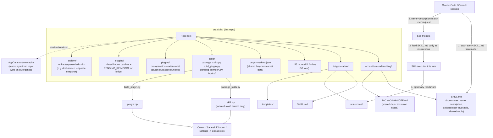

# ORA Authoritative Skills Library

This directory is the **source of truth** for Oxford Realty Advisors' custom Claude Code
"Skills" — the SKILL.md definitions (YAML frontmatter + Markdown instructions, plus
supporting `references/`, `scripts/`, `templates/`, and `assets/`) that drive deal
sourcing/underwriting, portfolio operations, finance, communications, and internal
automation across Gabriel Goldberg's real-estate business.

## What this repo is, and how a skill actually gets used

Each top-level folder is one Skill. A Claude Code / Cowork session discovers skills by
scanning every `SKILL.md`'s YAML frontmatter — the `name` and `description` fields are
matched against the user's request or the current task context to decide which skill(s)
to trigger (the `description` field is doing the routing work, which is why several
skills here pack it with explicit trigger phrases). Once triggered, the Skill tool loads
the Markdown body as working instructions for that turn, and the skill may in turn read
its own `references/*.md` for lookup data, invoke scripts under `scripts/`, or pull from
`templates/`/`assets/`. Skills are not code that "runs" independently — they are
structured context + procedure that Claude follows.

## Scope

Git-tracked as of 2026-04-16 (workflow-audit Fix #3a). Scoped to this subtree only — the
enclosing `Cowork OS/` and `OneDrive - Oxford Capital Partners (1)/` roots are NOT
git-tracked and must not be (they contain QBB backups, tenant PII, and financial
statements that should never enter a repo).

## Repo structure

**Reading the diagram:** everything lives flat under the repo root — each of the 57
skill folders (`acquisition-underwriting/`, `loi-generation/`, etc.) sits directly under
`Repo root`, alongside `target-markets.json` (shared buy-box data), `tools/`, `plugins/`,
`_staging/`, and `_archive/`. Inside a skill folder, only `SKILL.md` is required; the rest
(`references/`, `templates/`, `PACKAGING-NOTE.md`, and so on) exists only where that skill
actually needs it, which is why `acquisition-underwriting/` and `loi-generation/` are shown
with different contents. The bottom half of the diagram traces the two things that
actually happen to this repo: **packaging** (`tools/package_skills.py` or
`tools/build_plugin.py` zips a skill or plugin bundle for Cowork's "Save skill" import,
and a separate one-way sync mirrors shipped files into the AppData runtime cache — this
repo always wins on divergence) and **triggering** (a live Claude Code / Cowork session
scans every `SKILL.md`'s frontmatter, matches `name`/`description` against what the user
just asked for, and — once a skill triggers — loads its Markdown body as instructions for
that turn, optionally pulling from `references/` as it goes).

## Directory / skill inventory

**57 git-tracked skill directories** (each contains its own `SKILL.md`), plus four
non-skill support directories: `tools/` (packaging/build/hook scripts), `plugins/`
(version-controlled Cowork plugin bundles), `_staging/` (dated pending-reimport batches),
and `_archive/` (retired skills, kept for reference).

Grouped by rough function (one-line purpose pulled from each skill's frontmatter
`description`, condensed):

**Acquisition & deal lifecycle** — sourcing through close
- `acquisition-underwriting` — canonical entry point for deal evaluation (SCREEN / SNAPSHOT / UNDERWRITE / COMPS / FULL modes, Buy Box & Scorecard)
- `owner-outreach` — weekly off-market owner cold-outreach letter pipeline (draft only)
- `parcel-data-recovery` — county-level SF/value/year-built/delinquency recovery for off-market screens
- `ora-flood-zoning-dd` — FEMA flood + zoning/permitted-use due-diligence determinations
- `census-acs-extract` — Census ACS educational-attainment/migration data for market underwriting
- `ora-millage-lookup` — resolves a parcel's property-tax rate/taxable base from verified government endpoints; companion to acquisition-underwriting STAGE 2.5
- `market-monitor` — industrial market conditions, vacancy, rent growth, supply pipeline tracking
- `rent-comp` — rent and sale comparable research for target markets
- `submarket-spatial-analysis` — drive-time, demographics, and locational scoring
- `deal-comparison` — side-by-side deal and portfolio-fit comparison
- `loi-generation` — the sole letter-of-intent drafting path
- `deal-execution` — PSA negotiation through closing (redlines, DD checklist, closing statement)
- `psa-reconciliation` — PSA fact extraction/cascade reconciliation against the LOI
- `deal-retirement` — retires deal artifacts/tasks on close or kill; appends the decision ledger

**Portfolio & asset operations**
- `re-operations` — day-to-day operations across the multi-platform (Yardi/AppFolio/Rent Manager) portfolio
- `maintenance-analytics` — predictive maintenance and CapEx forecasting
- `tenant-intelligence` — tenant risk scoring, renewal probability, portfolio health metrics
- `rent-roll-qc` — final QC/polish pass on rent rolls before external delivery
- `rent-roll-reconciliation` — reconciles the Notion Tenant DB against an authoritative rent-roll export
- `lease-abstraction-pipeline` — single or batch lease abstraction / rent-roll extraction
- `lease-renewal-pipeline` — flags upcoming expirations and drafts renewal templates
- `lease-form-qc` — pre-execution QC gate for leases on ORA's own landlord form (42-defect scan, PASS/FAIL)
- `masterlease-jurisdiction-rebase` — rebases jurisdiction-conformed Master Lease property templates onto a new master revision; companion to lease-form-qc
- `legal-intelligence` — lease/contract clause library and legal document analysis
- `solar-lease-underwriting` — rooftop/community-solar lease underwriting: counterparty economics and rent-benchmarking for third-party rooftop energy leases
- `tax-appeal` — property tax assessment analysis and appeal decision engine
- `disposition-analysis` — hold / refinance / 1031 / sell decision engine
- `capex-budgeting` — multi-year capital plan and reserve studies
- `vendor-management` — vendor scoring, RFP issuance, contract intake, performance review

**Finance, capital & investor relations**
- `debt-management` — refinancing, lender selection, term-sheet negotiation, covenants
- `cash-position-monitor` — multi-entity consolidated cash position across QuickBooks accounts
- `investor-relations` — LP communications, capital calls, distributions, K-1s
- `portfolio-growth` — long-term AUM growth modeling and strategic capital planning
- `portfolio-reporting` — portfolio-level and investor-ready reporting output
- `monthly-close` — the full monthly accounting/operations close checklist
- `annual-cycle` — year-end/annual planning cycle (budget, tax planning, audit prep)
- `ratify-hurdle-rate` — formal ratification workflow for the firm's IRR hurdle rate
- `personal-portfolio` — Gabriel's personal investment portfolio analysis

**Communications & documents**
- `communication-intelligence` — context-enriched drafting for broker/lender/vendor/attorney mail
- `tenant-email` — tenant-facing email drafting (renewals, notices, maintenance, rent)
- `document-assembly` — template-driven document generation from Notion data (11 templates; not LOIs)
- `daily-brief` — daily CRE news/market/portfolio intelligence brief
- `conversation-archival` — archives decisions/analyses to the Notion Knowledge Base

**Systems, automation & infrastructure**
- `automation-health-monitor` — scheduled health check across the dual-fleet scheduled-task registry
- `fleet-advisory-remediation` — auto-triages fleet-status advisories, registers/retires tasks
- `orphaned-task-forensics` — root-causes stale scheduled-task output back to its producer
- `register-scheduled-task` — the sole supervised path for registering/updating scheduled tasks
- `exception-detection` — anomaly/exception scan across financial, tenant, and pipeline data
- `graph-app-registration` — Azure AD app registration / Microsoft Graph API access runbook
- `deploy-site` / `website-perfection` — build/deploy and optimize oxfordra.net
- `code-debugging-optimizations` — systematic debugging/repair for the site or any codebase
- `oxford-cc-strategic-audit` — strategic audit of the Oxford Command Center app
- `package-and-stage-skill` — packaging/staging helper for this repo itself
- `file-reconciliation` — hash-diff dedupe/reconciliation between file trees
- `build-with-gate-reviews` — gated build workflow for non-trivial multi-file subsystems
- `cowork-settings` — version/diff/publish the Cowork Global Settings document

**Shared data:** `target-markets.json` (repo root) — canonical buy-box market list,
consumed by `acquisition-underwriting`, `daily-brief`, `deal-comparison`, `market-monitor`,
and `rent-comp`. Not duplicated into any skill folder — see "Conventions" below.

## Conventions

- **Frontmatter:** every `SKILL.md` opens with a `---`-delimited YAML block. `name` and
  `description` are required and drive triggering; `description` has an effective
  **~1024-character budget** — skills that need more trigger vocabulary than that push
  the overflow into a `## BODY TRIGGERS` section in the body rather than bloating
  frontmatter (see `acquisition-underwriting`). Optional fields observed: `user-invocable:
  true` (slash-invocable) and `allowed-tools: <space-separated list>` (an explicit
  tool/MCP allow-list, e.g. `tenant-email`, `deploy-site`, `lease-renewal-pipeline`).
- **Versioning is inline, not a separate CHANGELOG file.** Skills carry their version and
  a dated changelog directly in the H1 heading and/or body paragraphs (e.g. `# Acquisition
  Underwriting — Oxford Realty Advisors (v4.4 — Buy Box & Scorecard v1.1)`, followed by
  `**v4.4 (2026-07-23):** ...`). Entries typically state what changed and explicitly note
  whether any scored/governor constant (DSCR, LTV, scorecard weights) was touched —
  financial-governor skills treat that as a required line, not optional color.
  Naming inside a folder is plain: `SKILL.md`, plus an optional `PACKAGING-NOTE.md`,
  `INSTALLATION.md`, or `SCHEDULED_TASK.md` for skill-specific operational notes.
  `references/`, `scripts/`, `templates/`, and `assets/` are the only supporting-file
  subfolder names in use.
- **Packaging:** to install/update a skill on the Cowork platform it must be zipped as a
  `.skill` and imported (Cowork "Save skill", or Settings → Capabilities). **Never use
  PowerShell `Compress-Archive`** — it writes backslash zip-entry paths that violate the
  zip spec and the Claude importer rejects with "Zip file contains path with invalid
  characters." Always package with `python tools/package_skills.py <outdir> [skill ...]`,
  which emits forward-slash entries and validates them. Skills bundled into a Cowork
  plugin (currently the `ora-operations-extensions` plugin) are built instead via `python
  tools/build_plugin.py <plugin-name> <outdir>` from `plugins/<plugin-name>/plugin-build.json`.
- **Shared root data** (like `target-markets.json`) lives once at repo root and is
  injected at package time via `SHARED_ROOT_DEPS` in `package_skills.py` — it is never
  copied into a consuming skill's folder (that creates a duplicate zip entry). A
  `PACKAGING-NOTE.md` documents which skills consume it and enforces (via
  `tools/hooks/pre-commit`) that any edit bumps its `version`/`updated` fields.
- **Backup discipline:** per-file `.backup-<timestamp>` sidecars and
  `skill-audit-YYYYMMDD-HHMMSS/` snapshots are produced by audit/install passes and are
  `.gitignore`d — git history is the durable version-control layer; sidecars are for
  mid-session rollback only.
- **Dual-write discipline (automated 2026-07-26):** `tools/hooks/pre-commit` Check 4 runs
  `tools/sync_appdata_mirror.py --check-staged`, which copies every staged skill's shipped
  files into whichever AppData runtime-cache mirror(s) already have it installed
  (`.../skills-plugin/<uuid>/<uuid>/skills/<skill>/` — discovered by glob, not a hardcoded
  path; a skill only has a mirror once it's been imported into Cowork at least once via
  "Save skill"/Settings → Capabilities). That cache is a rebuildable mirror, never the
  source of truth — this repo wins on divergence — and the sync is additive-only (never
  deletes anything already in the mirror) and never blocks a commit on a copy failure.
  Previously this was a manual convention only; it had "drifted stale before (once for a
  full month)" per this file's own prior wording.
- **Single-writer git discipline:** this repo is edited from multiple concurrent
  sessions/surfaces (Code + Cowork). Per `KNOWN_ISSUES.md`, run `git fetch origin` +
  `git status -sb` and inspect `git diff --cached --stat` before any commit; stage
  explicit paths, never broad globs or `git commit -a`, and split any commit whose
  `--stat` shows files you didn't touch. Cowork sandbox sessions specifically cannot
  reliably perform git *write* operations through the folder bridge (read-only ops like
  `status`/`diff`/`log` work) — do git writes from a Code-surface session.
- **Retirement, not deletion:** superseded skills move to `_archive/` rather than being
  deleted (e.g. `deal-screen`, `cap-rate-snapshot`, `market-comp-analyzer`, and the
  earlier `underwrite` were subsumed by `acquisition-underwriting`'s SCREEN/SNAPSHOT/COMPS
  modes and archived, reversibly, on 2026-06-07).

## Runtime skill dependencies (outside this repo)

Anthropic-core skills (`docx`, `xlsx`, `pptx`, `pdf`, `mcp-builder`, `schedule`,
`skill-creator`, `setup-cowork`, `consolidate-memory`, `init`, `review`,
`security-review`) resolve from the platform at runtime and are intentionally not
vendored here. If a future ORA-specific skill is added via a plugin before being pulled
into this repo, it should be noted explicitly so Recovery (below) doesn't silently miss
it — as of the last audit, no ORA-specific skill remained plugin-only-and-unvendored.

## How to add or edit a skill

1. Create a new top-level folder named exactly as the skill's intended `name`
   (kebab-case, matching existing folders).
2. Add `SKILL.md` with the YAML frontmatter block (`name`, `description` written to
   trigger correctly — front-load the phrases a user would actually say; keep it inside
   the ~1024-char budget and push overflow trigger vocabulary into a `## BODY TRIGGERS`
   section instead) followed by the Markdown instruction body. Add `user-invocable: true`
   and/or `allowed-tools` only if the skill needs them.
3. Put versioning inline: a `vX.Y (YYYY-MM-DD): ...` note in the H1 or immediately below
   it describing what changed, and — for anything touching scored logic or a governor
   constant — an explicit statement of whether that constant changed.
4. Add `references/`, `scripts/`, `templates/`, or `assets/` subfolders only as needed;
   don't duplicate repo-root shared data (like `target-markets.json`) into the skill
   folder — document the dependency in a `PACKAGING-NOTE.md` instead.
5. Package with `python tools/package_skills.py <outdir> <skill-name>` (or
   `tools/build_plugin.py` if the skill ships inside a plugin bundle) and import the
   resulting `.skill`/`.plugin` into Cowork. Never hand-zip with PowerShell
   `Compress-Archive`.
6. Follow the dual-write and single-writer discipline above: this repo is canon, the
   AppData cache is a rebuildable mirror, and commits must be fetched/checked/scoped
   before landing given concurrent sessions.
7. If retiring a skill, move its folder into `_archive/` rather than deleting it, and
   note the supersession reason and date.
8. Update the inventory in this README — it has drifted stale before (once for a full
   month) when a skill was added or archived without a matching README update.

## Recovery

If this directory is ever lost:
1. Git pull from the remote (`github.com/ZeOoba/ora-skills`, private).
2. Fall back to the `skill-audit-YYYYMMDD-HHMMSS/` backup snapshots in
   `C:/Users/Owner/.claude/backups/`.
3. Last resort: re-export from Cowork Desktop via the claude.ai skills UI.
