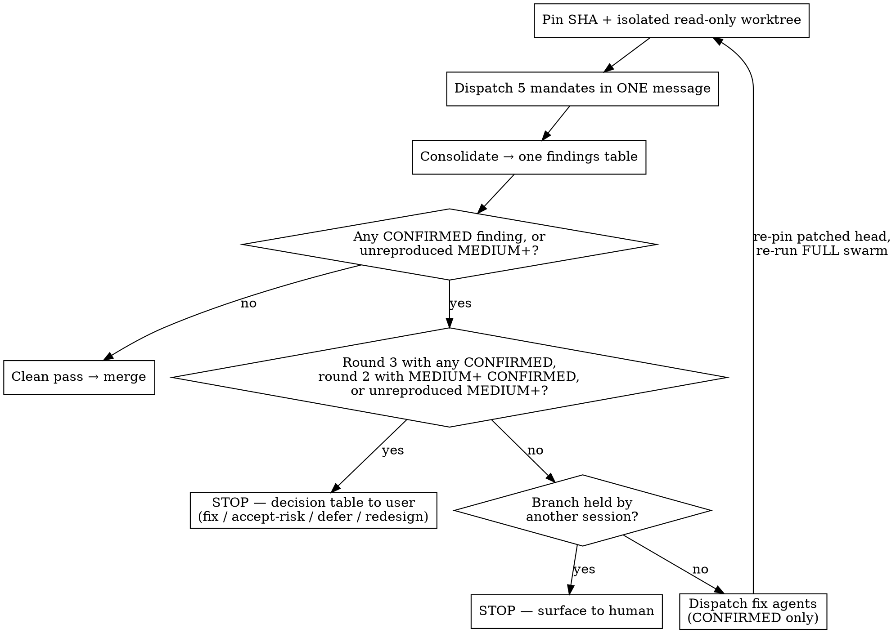

# Adversarial merge gate

Five reviewers, one narrow mandate each, no knowledge of each other's findings, all
against one pinned diff. Then fixes for confirmed findings only, then the whole swarm
again on the patched diff. Nothing merges without a clean pass (or the user's explicit
risk decision, see *Round budget and the findings ledger*).

**Core principle: independence is the product.** One reviewer with five concerns
subconsciously trades them off and returns the two easiest. Five reviewers with one
concern each cannot trade. The moment they can see each other's findings, you are back to
one reviewer with extra steps.

## When to use

- A **blast-radius** PR: `hooks/**`, `*.env*`, credentials, `settings.json`, `CLAUDE.md`
  or other governance config, scheduled-task registries, CSP/headers, financial-constant
  or governor files.
- Financial-decision or security-gate code, where the Done bar already mandates an
  adversarial REFUTE pass.
- Any branch in a **shared checkout** other sessions may be writing concurrently.
- Any PR whose **commit message asserts verification** ("all tests pass", "16/16 parse",
  "reviewed and approved"). Those claims are the highest-yield thing in the gate.
- A bot status check is green and nothing else has looked. **A bot check is never a
  review verdict.**

Skip it for trivial, single-file, single-session changes with no downstream consumers.
Running a five-agent swarm on a typo fix trains everyone to ignore the gate.

## The loop



Re-run the **full** swarm on the patched diff, not just the mandates that fired. A fix is
a new change and earns a new review; fixes are exactly where regressions enter. Rounds are
budgeted: after round 2 a MEDIUM+ finding goes to the user, not into round 3 (see *Round
budget and the findings ledger*).

## Step 1 — Pin before you look

Two failures this prevents, both real:

- **The branch moves under you.** If another session is pushing to it, findings cite line
  numbers that no longer exist and the merge decision covers a diff nobody reviewed.
- **Reviewers read the live tree.** Agents pointed at a shared checkout wander into other
  sessions' worktrees and review their uncommitted work as if it were the PR.

```bash
git fetch --quiet origin
HEAD_SHA=$(git rev-parse origin/<branch>)
BASE_SHA=$(git merge-base origin/main "$HEAD_SHA")
git worktree add --detach "$SCRATCH/gate-review" "$HEAD_SHA"
git diff "$BASE_SHA".."$HEAD_SHA" > "$SCRATCH/pr.diff"
```

Verify the base actually is the merge-base and that main has not moved past the branch.
Record both SHAs in the findings table — a verdict without the SHA it applies to is not a
verdict.

**Main moves during a long gate, not just the branch.** A multi-round gate can span hours.
Re-run `git fetch` and re-read `origin/main` before EVERY dispatch (including re-runs after
a fix), not only the first. If main advanced (a README-only PR landed mid-gate on PR #127),
merge it in server-side (`gh pr update-branch`), fast-forward locally, and re-pin: the base
SHA and the diff both change, and reviewers must be told which changes are main's and not
the PR's. Only do this if no other session holds the branch (next paragraph).

**Before dispatching, check who else holds the branch.** In a shared checkout, enumerate
live claims and in-flight worktrees. This is not hygiene; it decides whether Step 4 is
even permitted.

## Step 2 — Translate the mandate to the substrate

The five mandates are written for executable code. Applied verbatim to a diff of docs,
config, or definition files, two of them have no surface — and an agent that believes it
must produce findings will invent them.

Before dispatch, restate each mandate in terms of what the diff actually contains:

| Mandate | Code substrate | Config / definition substrate |
|---|---|---|
| Correctness prover | Functions, boundaries, error paths | Parser and loader inputs, declared-contract violations, identifier collisions, escaping that parses but does not round-trip |
| Race hunter | Locks, shared memory, transactions | Shared mutable state the definition instructs a future actor to read-modify-write |
| Test-validity | Mutate implementation, assert tests fail | Mutate the **validator** that should cover this file class; re-run the commit's own verification claims |
| Scope and staging | Same either way — commit message vs. tree | Same either way |
| Blast radius | Callers, imports, API consumers | Routing/trigger collisions, scheduled tasks, dependent skills |

Scope and staging is substrate-independent, which is part of why it yields most.

## Step 3 — Dispatch

All five in **one message** so they run concurrently. Prompt templates:
`agent-prompts.md` in this directory.

Right before dispatch (after writing any override of your own), list
`~/.claude/hooks/sessions/<your session>/` and `overrides/` with names, modification
times and the contents of any `override`; list `reviews/` recursively; and record the
value of `code-edits.count`, the listing of `~/.claude/hooks/active-work/`, and the
`touched-files.txt` of every other session holding a claim. Step 4 compares against this
listing.

Four clauses every mandate needs, and the reason each exists:

1. **Read-only, worktree-scoped, live tree named as forbidden.** Otherwise agents edit
   what you told them to review.
2. **Evidence bar** — a finding requires a command that was actually run and its real
   output. Kills the plausible-sounding-but-false finding.
3. **Zero findings is a valid and expected outcome; manufacturing one is a mandate
   failure and will be discarded.** Without this an agent under a "find problems" framing
   reliably produces something. This clause is what makes a clean pass mean anything.
4. **Guard surface is off limits.** Never create, edit or move anything under
   `~/.claude/hooks/` (override markers, tokens, claims), and never encode, obfuscate or
   split command text to get past a guard. A blocked command is reported, not worked
   around. If a repo has a sanctioned workaround for a known false positive (such as
   the scratchpad-glob pattern for site-marker reads), name it in the dispatch prompt;
   reviewers use only the workarounds you name. Reviewers run as subagents of your
   session, so a marker one of them writes exempts *your* session from that gate for
   the rest of the run. In the PR #89 gate a test-validity reviewer blocked by
   `eos-plan-gate` on its scratch harness scripts wrote the override marker itself,
   and base64-encoded a site path in one command, which would have got it past the
   site-write guard. Only the orchestrating session writes an override, and only
   where that gate's own rules allow it (the site-write token needs the user's
   in-turn go-ahead).

   `eos-plan-gate` counts every code-file Write/Edit in the session, scratch copies
   included, and denies the 4th. Reviewers share your session, so a swarm with a
   mutation harness will hit it. When a mandate will write scratch code, write the
   plan-gate `override` yourself before dispatch, with the reason (e.g. "merge gate
   PR #N: throwaway mutation-harness scripts outside the repo"), rather than leaving
   the reviewer to stall or improvise.

### Ask for the outcome a user sees, not only that the parts exist

A reviewer told to "check the map loads" confirms pins and tiles exist and reports clean.
On PR #127 four review rounds did exactly that while a bare `?view=map` link opened the map
at world zoom (every pin stacked) — found only by loading the live page afterwards. For any
UI, redirect or generated-output change, put the observable result in the mandate: the zoom
or framing, the final URL after redirects, the text a visitor reads, the file's bytes. Count
what a user would see, and test the deep link and the empty/zero-size start, not only the
happy path.

### When a mandate has no surface

Do not drop the agent — redirect it, in this order:

1. Does a validator/gate exist that is *supposed* to cover this file class? Mutation-test
   **that**. A validator which passes a deliberately broken input is a false-passing
   assertion, and it is the highest-value finding available on a docs diff.
2. Re-run the commit message's verification claims independently.
3. Report coverage observations, explicitly labelled as such — not as defects.

### Hand over suspicions as questions, never as findings

If setup surfaced a possible defect, phrase it as an item to **adjudicate against the
tree**, with an instruction to count: *"determine what the rest of the repo actually does
— count X vs. Y — and report whether this PR is consistent."* Phrased as a fact, an agent
confirms it. Phrased as a question, an agent can come back and tell you that you were
wrong. Seeding findings destroys the independence you paid five dispatches for.

## The sixth mandate — permission and guard coverage

The five mandates above share a blind spot, found by running them against a control:
**a new capability grant whose guard does not cover it.** It is not correctness (the file
parses), not a race, not test-validity, not scope (the commit disclosed it), and not
blast-radius (nothing downstream consumes it yet). It falls between all five.

Dispatch it whenever a diff adds or widens a permission, tool grant, credential scope,
network egress, or execution capability:

> For every capability this diff grants — tool, permission, egress, execution, credential
> scope — identify the guard, hook, matcher, or policy that is supposed to constrain it,
> and TEST whether that guard actually matches the new capability. Report every grant with
> no matching guard. Compare against the nearest existing holder of the same capability
> and report any protective clause present there and absent here.

Test the matcher, do not read it. A regex that looks like it covers a tool frequently
does not, and the difference is invisible until you run the tool name against it.

## Step 4 — Consolidate, then STOP before fixing

Before consolidating, check the swarm against clause 4. List
`~/.claude/hooks/sessions/<your session>/` and `overrides/` again, with names,
modification times and the contents of any `override`, and compare it with the Step 3
listing. The bypass markers are `override`, `plan-approved`, `allow-foreign-commit`,
anything under `overrides/` and anything under `reviews/` (listed recursively); any of
them that is new or changed since that listing is a breach. So is any new, changed or
deleted file under `~/.claude/hooks/active-work/`, and any change to another session's
`touched-files.txt`, that this run did not cause. A decrease or deletion of `code-edits.count`
is a breach (it resets the plan gate's edit limit) unless `plan-gate-resets.log` has a
matching new reset line. Other counters, logs, `touched-files.txt` of this session and
`gate-green` are written by the hooks during normal tool use and are expected. A user prompt with two or more "Phase N:" headers
also makes the router write `plan-approved`; attribute it to that prompt, not a swarm agent. Archive a breach marker (never delete) to
`~/.claude/hooks/sessions/_archive_override_tokens/`, the folder
`override-token-frequency-probe.py` reads and the weekly sweep archives into:
- `overrides/<tier>` goes to `<session>_overrides_<tier>`, so the probe counts it.
- A plain `override` goes to `<session>_override.breach-<YYYY-MM-DD>`. The suffix
  stops the weekly sweep (`Move-Item -Force` to `<session>_override`) from later
  overwriting the evidence with a legitimate override of yours.

Report every breach to the user alongside the findings.

One table, most severe first:

| Sev | Agent | file:line | Reproduction | Proposed fix | Verdict |
|---|---|---|---|---|---|

`Verdict` is **CONFIRMED** only if the reproduction was executed and observed.
Everything else is **UNCONFIRMED** and does **not** get a fix agent. Dispatching fixes for
unconfirmed findings is how a review swarm damages a working branch.

**The gate stops here — it does not merge — when any of these hold:**

- Another session holds a claim on the branch or its paths. Patching a live writer's
  branch corrupts their work; that is the exact hazard mandate 2 exists to find, and the
  gate must not commit it.
- A finding is real but the right fix is a judgment call (doctrine conflict, scope
  question, product decision).
- Agents disagree, or a finding contradicts the commit message's account of intent.
- The round budget is exhausted, or round 2 still has a CONFIRMED MEDIUM+ finding (see
  *Round budget and the findings ledger*).

Report these. Do not guess. A merge gate that resolves ambiguity by guessing is worse than
no gate, because it launders the guess as a verdict.

## Step 5 — Fix and re-run

Before dispatching round N+1, check the round counter and update the ledger (see *Round
budget and the findings ledger*).

Fix agents get one confirmed finding each and the same read-only discipline everywhere
except their assigned file. Their prompts carry the two NEVER lines at
`agent-prompts.md` preamble lines 22-28 (no create/edit/move under `~/.claude/hooks/`; no
encoding or splitting command text to pass a guard), verbatim, plus: do not invoke lane
skills (/plan, /build, /debug, /refactor, /research, /ship) and do not write under
`docs/superpowers/plans/` or `.claude/plans/` (either writes `plan-approved`). Then re-pin the new head and re-run the **full** swarm.

Merge only on a clean pass: zero CONFIRMED findings, no unreproduced MEDIUM+ finding, no
ledger row still FIXED-CLAIMED, every mandate reporting either findings-resolved or
no-surface-with-evidence, or the user explicitly chose accept-risk / defer for each open
finding (see Round budget). Accept-risk does not override the other-session-claim stop in
Step 4, and does not satisfy a repo's own refute gate (`check:refute` / `Refute-Reviewed:`
trailer for financial code).

**Stop reviewers a fix has superseded.** When a fix re-pins the head, in-flight reviewers
on the old SHA are reviewing a diff nobody will merge. Stop them (TaskStop) instead of
letting them finish, keep any finding they had already reported, and dispatch the new swarm
on the new pin. Running both generations at once only burns RAM and muddies which SHA each
verdict applies to. Once the fix agents have finished and the superseded reviewers are
stopped (confirm they and any background jobs they started have ended), run the Step 4
breach check against the previous generation's listing BEFORE writing any override of your
own for the next round and before taking the new pre-dispatch listing, so a marker a fix
agent or a stopped reviewer wrote is reported rather than absorbed into the new baseline.
If a fix needs a plan-gate override mid-Step 5, first stop or wait out every in-flight fix
agent and reviewer (and their background jobs), run the check, then write the override and
re-list immediately. That re-list replaces the previous listing as the baseline for the
end-of-Step 5 check; anything that changed before the check is a breach.

**Scoped re-run: a user decision, never the default.** The default stays the full swarm.
When the only CONFIRMED findings are LOW, cosmetic, or confined to one file's write path,
the user may explicitly authorize re-running only (a) the mandates that reported and (b)
any mandate whose surface the fix touches. Never choose this yourself. When used, the
verdict must record, per mandate, the SHA it last passed on and why it was not re-run, so
the delta no mandate saw is on the page. A comment-only or test-cleanup tidy after the
last pass is the same kind of unreviewed delta: verify it with the build and tests, and
list it in the verdict as unreviewed.

## Round budget and the findings ledger

The loop above has no ceiling and, left alone, no memory. Three real gates show what that
costs:

| Gate | Rounds | What each round found | What ended it |
|---|---|---|---|
| Aggregate-LTV register change | 8 BLOCK | One more case per round; one fix introduced a NEW high-severity regression | Nothing: the work stayed frozen and uncommitted; no decision point was ever forced |
| Upload-parser hardening PR | 11 | A new bypass of the same mechanism every round | Design change: child-process isolation |
| Hook stating whether a push/commit/merge landed | 4 BLOCK | Each round, another shell construct that made it name the wrong repo | Redesign: state only observed facts |

In each, a decision after round 2 would have beaten another full swarm.

**A round** is one pinned swarm dispatch, its consolidation, and the fixes for its
CONFIRMED findings. Round 1 is the first swarm. A user-authorized scoped re-run counts as
a round. A re-dispatch caused only by main moving (Step 1) keeps its round number. **Default
cap: 3 rounds per gate.** The cap binds the orchestrating agent; only the **user** can
raise it, explicitly, and the ledger records who raised it and why. If this PR was gated
before and no ledger is found, do not restart at round 1: rebuild the round count from the
prior verdicts or ask the user, and put the round number and any cap raise in every verdict.

**Severity is the reviewer's.** The orchestrator may raise it but never lowers it without
the user's words, recorded in the ledger.

**Stop rule after round 2.** If round 2 (the first re-run on a patched diff) has any
CONFIRMED finding of MEDIUM or above, new or carried over, do NOT start round 3 on your own. Stop and give the
user ONE decision table, one row per open CONFIRMED finding:

| ID | Sev | Class | Agent, file:line | Reproduction | Verdict | Fix cost (small/medium/large + files) | Recommendation |
|---|---|---|---|---|---|---|---|

For each finding the user chooses exactly one of:

- **fix** — another round. After round 2 this is round 3 and stays inside the default cap;
  only at the cap does "fix" mean the user is raising it (see "At the cap").
- **accept-risk** — merge with the finding open; the user's explicit words go in the ledger
  and the verdict.
- **defer** — merge only once it has a named human owner and a tracking entry outside the
  scratch directory (issue or KNOWN_ISSUES.md), linked in the ledger and verdict; MEDIUM and
  below only.
- **redesign** — stop patching; change the approach.

Ask it as multiple choice, recommended option first. The orchestrating agent NEVER picks
accept-risk or defer for any finding, and never merges with an open finding unless the user
chose accept-risk or defer for it in words. Only the user's words set ACCEPTED-RISK or
DEFERRED. Silence is not a choice. An unreproduced (UNCONFIRMED) MEDIUM+ finding is not
fixed, but it joins the table as UNCONFIRMED for the user's call.

**A clean round escapes the cap.** A round 2 or 3 with zero CONFIRMED findings and no
unreproduced MEDIUM+ finding is a clean pass; the gate proceeds to merge normally. The cap
only bites when rounds keep finding things.

**At the cap.** Round 3 with CONFIRMED findings of MEDIUM or above ends the gate with NO
merge and the same table, without "fix (another round)" as the default; it is offered only
as an explicit user choice that raises the cap. Open LOW findings join the table; still no
merge on your own.

**Defect class and the redesign signal.** Give every finding a short class label, e.g.
`wrong-repo via shell construct`, `bypass of guard X`, `false fact from inferring intent`,
`test masks defect`. A class names the mechanism, not the instance; reuse an earlier class
unless the ledger states why not. When two consecutive rounds each produce a new finding in
the SAME class, or a fix introduced a new finding of equal or higher severity (a fix-induced
regression; any finding whose file:line is in a fix commit's hunk counts), say so in the table and make **redesign** the recommended option: the
mechanism is leaking, and patching instances will not converge (table above).

**Full suite after every fix.** Run the repo's FULL test suite, not only the test written
for the finding, and record pass/fail counts in the ledger. A fix that turns a previously
passing test red is a fix-induced regression and counts as a new finding. A CPU-bound
suite must not run while a review swarm is running: load turns tests into timeouts and the
failures get misread as regressions. Run it with no reviewer active. A failure seen under
load is re-run with no reviewer active before it is dismissed, and a caveated run never
counts as the after-fix suite.

### The findings ledger

`findings-ledger.md`, next to `pr.diff` in the Step 1 SCRATCH directory — never under
`~/.claude/hooks/`, never committed to the reviewed branch. One row per finding. Keep each
reproduction as a file or fenced block next to the ledger (`repro-F-001.sh`) and cite it in
the row: a command pasted through a table cell loses its pipes and quoting, and a mangled
probe "no longer reproduces" for the wrong reason. Probes are pasted from those files.

| ID | Round | Sev | Class | Mandate | file:line | Reproduction | Status | Fix SHA | Verified in round | Suite after fix | User decision (words) |
|---|---|---|---|---|---|---|---|---|---|---|---|
| F-001 | 1 | HIGH | wrong-repo via shell construct | Correctness | hook.py:88 | see `repro-F-001.sh` | VERIFIED-CLOSED | a1b2c3d | 2 | 212/212 | — |
| F-002 | 2 | HIGH | wrong-repo via shell construct | Blast radius | hook.py:131 | see `repro-F-002.sh` | OPEN (redesign recommended: same class two rounds running) | — | — | — | — |
| F-003 | 2 | MEDIUM | test masks defect | Test-validity | test_hook.py:40 | see `repro-F-003.sh` (mutated copy in scratch) | OPEN | — | — | — | — |

Status is one of OPEN / FIXED-CLAIMED / VERIFIED-CLOSED / ACCEPTED-RISK / DEFERRED /
REDESIGNED-AWAY, and moves only on evidence: FIXED-CLAIMED becomes VERIFIED-CLOSED only
when a LATER round's reviewer re-ran the reproduction at the new pinned SHA and it no
longer reproduces. The decision table is the Step 4 table with Class, Fix cost and
Recommendation columns added, not a new report format.

**How the ledger reaches reviewers without breaking independence.** The Step 3 rule —
*suspicions as questions, never findings* — applies across rounds. From round 2 on, give
every mandate the FIXED-CLAIMED reproductions as **regression probes** phrased as
questions (wording: `agent-prompts.md`, *Round 2+ regression probes*), e.g. "At the pinned
SHA, run `<command>`. Does it still produce `<symptom>`? Report the output either way."
Do NOT hand over other mandates' current findings or open items. Reviewers keep their own
mandate and the zero-findings clause. A probe that still reproduces is reported as a
REGRESSION finding, severity at least the original. A probe is a test, not a hint to find
more.

## Common mistakes

| Mistake | Why it breaks the gate |
|---|---|
| Reviewing a branch ref instead of a pinned SHA | Verdict applies to a diff nobody reviewed |
| Letting agents see each other's findings | Five reviewers collapse into one |
| Omitting "zero findings is valid" | Guarantees manufactured findings; clean pass becomes meaningless |
| Seeding your own suspicion as fact | Agent confirms it; you lose the chance to be corrected |
| Fixing UNCONFIRMED findings | Damages a working branch on a guess |
| Re-running only the mandates that fired | Misses regressions introduced by the fixes (a scoped re-run is allowed only when the user explicitly authorizes it; see Step 5) |
| Reviewers verify parts exist, not the visible result | A deep-link framing bug passed four rounds that all confirmed "pins and tiles load" |
| Fetching main once at the start | Main moves during a long gate; the base SHA and diff go stale |
| Letting superseded reviewers finish | Their verdict applies to a diff nobody will merge |
| Running the swarm on a trivial diff | Trains everyone to ignore the gate |
| Treating a green bot check as a review | A bot check is never a review verdict |
| Starting round 4 (or round 3 after a MEDIUM+ round 2) without the user because the last fix was small | Fix-induced regressions arrive exactly in the small ones; the cap exists to force the decision |
| Patching the Nth instance of one defect class | The mechanism is leaking; stop and offer redesign |
| Running the full suite only for the new test | Regressions from fixes pass the narrow test |
| Running a CPU-bound gate while the swarm runs | Load turns tests into timeouts; failures get misread as regressions |
| Handing last round's other findings to reviewers | Independence: hand over only FIXED-CLAIMED regression probes as questions |

## Red flags — STOP

- "The branch is probably stable, I'll skip pinning."
- "This finding is obviously right, no need to reproduce it."
- "Another session owns this branch but the fix is small."
- "Only mandate 4 fired, no need to re-run the others." (Unless the user explicitly chose a scoped re-run, Step 5.)
- "This is round 3, but only a LOW/MEDIUM cosmetic one is left, I will just run one more."
  — **Round 3 is the cap.** Stop, write the decision table, let the user choose.
- "The user is waiting, so I will pick accept-risk for them." — **Never.** Ask the table as
  multiple choice; no answer means no merge.
- "The agent found nothing, it must not have tried hard enough." — **A well-evidenced
  no-findings result is a pass, not a failure.** Re-dispatching until an agent produces a
  finding manufactures one.
