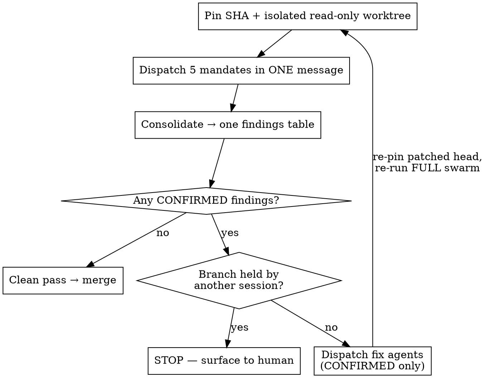

# Adversarial merge gate

Five reviewers, one narrow mandate each, no knowledge of each other's findings, all
against one pinned diff. Then fixes for confirmed findings only, then the whole swarm
again on the patched diff. Nothing merges without a clean pass.

**Core principle: independence is the product.** One reviewer with five concerns
subconsciously trades them off and returns the two easiest. Five reviewers with one
concern each cannot trade. The moment they can see each other's findings, you are back to
one reviewer with extra steps.

## When to use

- A **blast-radius** PR: `hooks/**`, `*.env*`, credentials, `settings.json`, `CLAUDE.md`
  or other governance config, scheduled-task registries, CSP/headers, financial-constant
  or governor files.
- Financial-decision or security-gate code, where the Done bar already mandates an
  adversarial REFUTE pass.
- Any branch in a **shared checkout** other sessions may be writing concurrently.
- Any PR whose **commit message asserts verification** ("all tests pass", "16/16 parse",
  "reviewed and approved"). Those claims are the highest-yield thing in the gate.
- A bot status check is green and nothing else has looked. **A bot check is never a
  review verdict.**

Skip it for trivial, single-file, single-session changes with no downstream consumers.
Running a five-agent swarm on a typo fix trains everyone to ignore the gate.

## The loop



Re-run the **full** swarm on the patched diff, not just the mandates that fired. A fix is
a new change and earns a new review; fixes are exactly where regressions enter.

## Step 1 — Pin before you look

Two failures this prevents, both real:

- **The branch moves under you.** If another session is pushing to it, findings cite line
  numbers that no longer exist and the merge decision covers a diff nobody reviewed.
- **Reviewers read the live tree.** Agents pointed at a shared checkout wander into other
  sessions' worktrees and review their uncommitted work as if it were the PR.

```bash
git fetch --quiet origin
HEAD_SHA=$(git rev-parse origin/<branch>)
BASE_SHA=$(git merge-base origin/main "$HEAD_SHA")
git worktree add --detach "$SCRATCH/gate-review" "$HEAD_SHA"
git diff "$BASE_SHA".."$HEAD_SHA" > "$SCRATCH/pr.diff"
```

Verify the base actually is the merge-base and that main has not moved past the branch.
Record both SHAs in the findings table — a verdict without the SHA it applies to is not a
verdict.

**Main moves during a long gate, not just the branch.** A multi-round gate can span hours.
Re-run `git fetch` and re-read `origin/main` before EVERY dispatch (including re-runs after
a fix), not only the first. If main advanced (a README-only PR landed mid-gate on PR #127),
merge it in server-side (`gh pr update-branch`), fast-forward locally, and re-pin: the base
SHA and the diff both change, and reviewers must be told which changes are main's and not
the PR's. Only do this if no other session holds the branch (next paragraph).

**Before dispatching, check who else holds the branch.** In a shared checkout, enumerate
live claims and in-flight worktrees. This is not hygiene; it decides whether Step 4 is
even permitted.

## Step 2 — Translate the mandate to the substrate

The five mandates are written for executable code. Applied verbatim to a diff of docs,
config, or definition files, two of them have no surface — and an agent that believes it
must produce findings will invent them.

Before dispatch, restate each mandate in terms of what the diff actually contains:

| Mandate | Code substrate | Config / definition substrate |
|---|---|---|
| Correctness prover | Functions, boundaries, error paths | Parser and loader inputs, declared-contract violations, identifier collisions, escaping that parses but does not round-trip |
| Race hunter | Locks, shared memory, transactions | Shared mutable state the definition instructs a future actor to read-modify-write |
| Test-validity | Mutate implementation, assert tests fail | Mutate the **validator** that should cover this file class; re-run the commit's own verification claims |
| Scope and staging | Same either way — commit message vs. tree | Same either way |
| Blast radius | Callers, imports, API consumers | Routing/trigger collisions, scheduled tasks, dependent skills |

Scope and staging is substrate-independent, which is part of why it yields most.

## Step 3 — Dispatch

All five in **one message** so they run concurrently. Prompt templates:
`agent-prompts.md` in this directory.

Right before dispatch (after writing any override of your own), list
`~/.claude/hooks/sessions/<your session>/` and `overrides/` with names, modification
times and the contents of any `override`. Step 4 compares against this listing.

Four clauses every mandate needs, and the reason each exists:

1. **Read-only, worktree-scoped, live tree named as forbidden.** Otherwise agents edit
   what you told them to review.
2. **Evidence bar** — a finding requires a command that was actually run and its real
   output. Kills the plausible-sounding-but-false finding.
3. **Zero findings is a valid and expected outcome; manufacturing one is a mandate
   failure and will be discarded.** Without this an agent under a "find problems" framing
   reliably produces something. This clause is what makes a clean pass mean anything.
4. **Guard surface is off limits.** Never create, edit or move anything under
   `~/.claude/hooks/` (override markers, tokens, claims), and never encode, obfuscate or
   split command text to get past a guard. A blocked command is reported, not worked
   around. If a repo has a sanctioned workaround for a known false positive (such as
   the scratchpad-glob pattern for site-marker reads), name it in the dispatch prompt;
   reviewers use only the workarounds you name. Reviewers run as subagents of your
   session, so a marker one of them writes exempts *your* session from that gate for
   the rest of the run. In the PR #89 gate a test-validity reviewer blocked by
   `eos-plan-gate` on its scratch harness scripts wrote the override marker itself,
   and base64-encoded a site path in one command, which would have got it past the
   site-write guard. Only the orchestrating session writes an override, and only
   where that gate's own rules allow it (the site-write token needs the user's
   in-turn go-ahead).

   `eos-plan-gate` counts every code-file Write/Edit in the session, scratch copies
   included, and denies the 4th. Reviewers share your session, so a swarm with a
   mutation harness will hit it. When a mandate will write scratch code, write the
   plan-gate `override` yourself before dispatch, with the reason (e.g. "merge gate
   PR #N: throwaway mutation-harness scripts outside the repo"), rather than leaving
   the reviewer to stall or improvise.

### Ask for the outcome a user sees, not only that the parts exist

A reviewer told to "check the map loads" confirms pins and tiles exist and reports clean.
On PR #127 four review rounds did exactly that while a bare `?view=map` link opened the map
at world zoom (every pin stacked) — found only by loading the live page afterwards. For any
UI, redirect or generated-output change, put the observable result in the mandate: the zoom
or framing, the final URL after redirects, the text a visitor reads, the file's bytes. Count
what a user would see, and test the deep link and the empty/zero-size start, not only the
happy path.

### When a mandate has no surface

Do not drop the agent — redirect it, in this order:

1. Does a validator/gate exist that is *supposed* to cover this file class? Mutation-test
   **that**. A validator which passes a deliberately broken input is a false-passing
   assertion, and it is the highest-value finding available on a docs diff.
2. Re-run the commit message's verification claims independently.
3. Report coverage observations, explicitly labelled as such — not as defects.

### Hand over suspicions as questions, never as findings

If setup surfaced a possible defect, phrase it as an item to **adjudicate against the
tree**, with an instruction to count: *"determine what the rest of the repo actually does
— count X vs. Y — and report whether this PR is consistent."* Phrased as a fact, an agent
confirms it. Phrased as a question, an agent can come back and tell you that you were
wrong. Seeding findings destroys the independence you paid five dispatches for.

## The sixth mandate — permission and guard coverage

The five mandates above share a blind spot, found by running them against a control:
**a new capability grant whose guard does not cover it.** It is not correctness (the file
parses), not a race, not test-validity, not scope (the commit disclosed it), and not
blast-radius (nothing downstream consumes it yet). It falls between all five.

Dispatch it whenever a diff adds or widens a permission, tool grant, credential scope,
network egress, or execution capability:

> For every capability this diff grants — tool, permission, egress, execution, credential
> scope — identify the guard, hook, matcher, or policy that is supposed to constrain it,
> and TEST whether that guard actually matches the new capability. Report every grant with
> no matching guard. Compare against the nearest existing holder of the same capability
> and report any protective clause present there and absent here.

Test the matcher, do not read it. A regex that looks like it covers a tool frequently
does not, and the difference is invisible until you run the tool name against it.

## Step 4 — Consolidate, then STOP before fixing

Before consolidating, check the swarm against clause 4. List
`~/.claude/hooks/sessions/<your session>/` and `overrides/` again, with names,
modification times and the contents of any `override`, and compare it with the Step 3
listing. The bypass markers are `override`, `plan-approved`, `allow-foreign-commit` and
anything under `overrides/`; any of them that is new or changed since that listing is a breach.
Counters, logs, `touched-files.txt` and `gate-green` are written by the hooks during
normal tool use and are expected. Archive a breach marker (never delete) to
`~/.claude/hooks/sessions/_archive_override_tokens/`, the folder
`override-token-frequency-probe.py` reads and the weekly sweep archives into:
- `overrides/<tier>` goes to `<session>_overrides_<tier>`, so the probe counts it.
- A plain `override` goes to `<session>_override.breach-<YYYY-MM-DD>`. The suffix
  stops the weekly sweep (`Move-Item -Force` to `<session>_override`) from later
  overwriting the evidence with a legitimate override of yours.

Report every breach to the user alongside the findings.

One table, most severe first:

| Sev | Agent | file:line | Reproduction | Proposed fix | Verdict |
|---|---|---|---|---|---|

`Verdict` is **CONFIRMED** only if the reproduction was executed and observed.
Everything else is **UNCONFIRMED** and does **not** get a fix agent. Dispatching fixes for
unconfirmed findings is how a review swarm damages a working branch.

**The gate stops here — it does not merge — when any of these hold:**

- Another session holds a claim on the branch or its paths. Patching a live writer's
  branch corrupts their work; that is the exact hazard mandate 2 exists to find, and the
  gate must not commit it.
- A finding is real but the right fix is a judgment call (doctrine conflict, scope
  question, product decision).
- Agents disagree, or a finding contradicts the commit message's account of intent.

Report these. Do not guess. A merge gate that resolves ambiguity by guessing is worse than
no gate, because it launders the guess as a verdict.

## Step 5 — Fix and re-run

Fix agents get one confirmed finding each and the same read-only discipline everywhere
except their assigned file. Their prompts carry the two NEVER lines from the
`agent-prompts.md` preamble (no writes under `~/.claude/hooks/`; no encoding or splitting
command text to pass a guard), verbatim. Then re-pin the new head and re-run the **full** swarm.

Merge only on a clean pass: zero CONFIRMED findings, every mandate reporting either
findings-resolved or no-surface-with-evidence.

**Stop reviewers a fix has superseded.** When a fix re-pins the head, in-flight reviewers
on the old SHA are reviewing a diff nobody will merge. Stop them (TaskStop) instead of
letting them finish, keep any finding they had already reported, and dispatch the new swarm
on the new pin. Running both generations at once only burns RAM and muddies which SHA each
verdict applies to. Once the fix agents have finished and the superseded reviewers are
stopped, and before the new pre-dispatch listing is taken, run the Step 4 breach check
against the previous generation's listing, so a marker a fix agent or a stopped reviewer
wrote is reported rather than absorbed into the new baseline.

**Scoped re-run: a user decision, never the default.** The default stays the full swarm.
When the only CONFIRMED findings are LOW, cosmetic, or confined to one file's write path,
the user may explicitly authorize re-running only (a) the mandates that reported and (b)
any mandate whose surface the fix touches. Never choose this yourself. When used, the
verdict must record, per mandate, the SHA it last passed on and why it was not re-run, so
the delta no mandate saw is on the page. A comment-only or test-cleanup tidy after the
last pass is the same kind of unreviewed delta: verify it with the build and tests, and
list it in the verdict as unreviewed.

## Common mistakes

| Mistake | Why it breaks the gate |
|---|---|
| Reviewing a branch ref instead of a pinned SHA | Verdict applies to a diff nobody reviewed |
| Letting agents see each other's findings | Five reviewers collapse into one |
| Omitting "zero findings is valid" | Guarantees manufactured findings; clean pass becomes meaningless |
| Seeding your own suspicion as fact | Agent confirms it; you lose the chance to be corrected |
| Fixing UNCONFIRMED findings | Damages a working branch on a guess |
| Re-running only the mandates that fired | Misses regressions introduced by the fixes (a scoped re-run is allowed only when the user explicitly authorizes it; see Step 5) |
| Reviewers verify parts exist, not the visible result | A deep-link framing bug passed four rounds that all confirmed "pins and tiles load" |
| Fetching main once at the start | Main moves during a long gate; the base SHA and diff go stale |
| Letting superseded reviewers finish | Their verdict applies to a diff nobody will merge |
| Running the swarm on a trivial diff | Trains everyone to ignore the gate |
| Treating a green bot check as a review | A bot check is never a review verdict |

## Red flags — STOP

- "The branch is probably stable, I'll skip pinning."
- "This finding is obviously right, no need to reproduce it."
- "Another session owns this branch but the fix is small."
- "Only mandate 4 fired, no need to re-run the others." (Unless the user explicitly chose a scoped re-run, Step 5.)
- "The agent found nothing, it must not have tried hard enough." — **A well-evidenced
  no-findings result is a pass, not a failure.** Re-dispatching until an agent produces a
  finding manufactures one.
